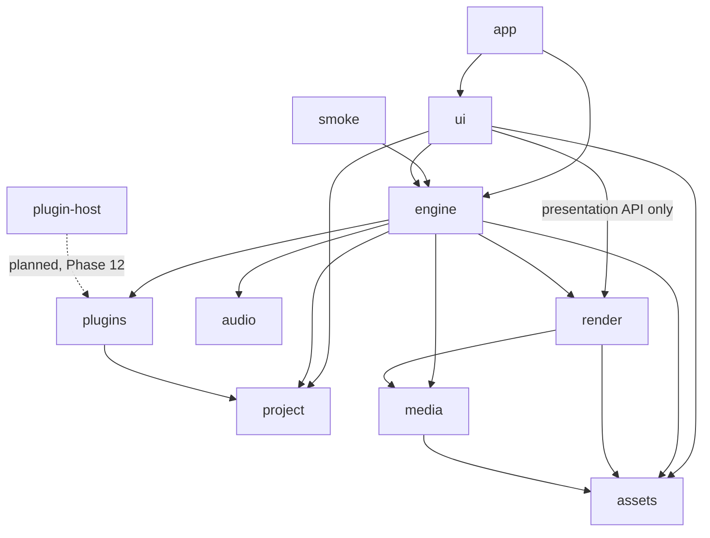
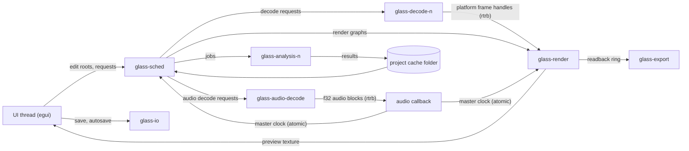
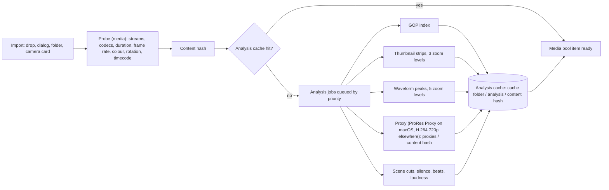
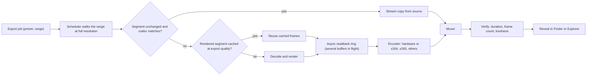
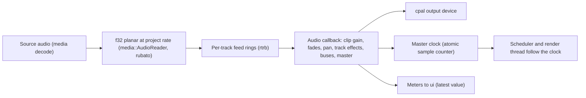

# Glass architecture

This document describes how Glass is built: the crates, the threads, how data moves between them, the caches, the GPU pipeline, and the stack chosen in Phase 0. `PLAN.md` is the source of truth for what gets built and in which order; this file is the source of truth for how the pieces fit. When a task changes data flow, this file changes in the same commit.

Status words used below:

- **Proven**: measured by a Phase 0 prototype in `experiments/proto-ui/`, `experiments/proto-gpu/` or `experiments/proto-decode/` (see [`experiments/README.md`](../experiments/README.md)).
- **Planned**: decided here, built in the phase named next to it.
- **Pending hardware**: decided, but the prototype could not run locally (no Windows PC, no NVIDIA GPU).

All local measurements come from an Apple M2 (8 logical cores, 10-core GPU), which stands in for the Apple M1 reference machine. The M1 is somewhat slower, so the numbers here are a lower bound for it.

---

## 1. Goals and budgets

Priority when goals conflict: **speed, then features, then size.**

| Budget | Limit | Enforced from | Current evidence |
| --- | --- | --- | --- |
| UI frame | under 8 ms at 120 Hz (8.33 ms per refresh) | Phase 1 frame-time monitor, every task | proto-ui: 200 clips on 10 tracks, UI-thread CPU (UI build + tessellation + paint + `Queue::submit`) median 0.37 ms, p99 0.74 ms offscreen; eframe `cpu_usage` in a window (excludes submit) median 1.37 ms, p99 3.00 ms |
| Scrub latency | under 50 ms | Phase 3 scrub benchmark | not measured end to end yet; accurate seek alone (`cargo bench -p media --bench seek`, M2, 200 random frames): software decode 1080p H.264 (30-frame GOP) median 13.6 ms, p95 22.5 ms; 720p60 (120-frame open GOP, B-frames) median 10.9 ms, p95 24.8 ms; 4K H.264 median 39.5 ms, p95 74.8 ms. VideoToolbox through FFmpeg is slower for seeks (one synchronous frame at a time, about 4.5 ms per 1080p frame): 1080p median 51.5 ms, p95 111 ms; 4K median 122 ms, p95 279 ms |
| Project open | under 1 s | Phase 16 open benchmark | not measured yet as a whole; `media` probe per file (`cargo bench -p media --bench probe`, M2): 0.16 ms ProRes MOV, 0.79 ms 640x360 H.264 MOV, 3.7 ms 1080p H.264 MP4, 4.0 ms VP9 WebM, 13.2 ms 4K H.264 MP4, 10.3 ms 1080p PNG |
| Cold start | under 1.5 s | Phase 16 benchmarks | not measured yet |
| Installer size | about 30 MB, excluding asset packs and models | Phase 1 size check (`scripts/size-check.sh` against `size-budget.toml`, 30 MiB per DMG, MSI, MSIX and AppImage) after each installer build in `package.yml` | arm64 DMG 11.99 MiB with the app icons (local, M2); this budget gives way to features and speed with a Decision Log entry |

Reference hardware: an Apple M1 Mac and a Windows PC with a GTX 1660 class GPU. Slower supported machines stay smooth by lowering preview resolution, never by dropping frames.

Consequences for every design choice below:

- The UI thread never blocks: no file I/O, no decode, no waiting on a GPU fence, no lock that another thread can hold for long.
- The audio callback never allocates, locks, or does I/O.
- Anything that can be computed ahead (thumbnails, waveforms, proxies, GOP indexes, rendered frames) is computed in the background and cached on disk or in memory.
- Everything cached is regenerable, except autosave data.

---

## 2. Crate layout

The Cargo workspace (Phase 1) has ten crates, each in `crates/<name>/` with a package of the same name. Two are binaries (`app` builds `glass`, `smoke` builds `smoke`); the rest are libraries. `experiments/` is excluded from the workspace. One more crate, `plugin-host`, is planned for Phase 12 and is not in the workspace yet; its row is marked *planned*.

| Crate | Responsibility | May depend on (workspace crates) | `unsafe` |
| --- | --- | --- | --- |
| `app` | The `glass` binary. Creates the eframe window (eframe creates the wgpu device and queue), passes that device and queue from `cc.wgpu_render_state` to `render`, starts the threads and the engine, then hands control to `ui`. Owns command-line flags, safe mode, portable mode, crash minidumps, and OS integration such as notifications. | `ui`, `engine` | only in `app::ffi` (attaching the crash handler, the deliberate test crash) |
| `ui` | egui panels and widgets: timeline, preview, media pool, inspector, browsers, colour, audio, export, settings, debug panel. Theme and i18n application. Turns input into edit commands and engine requests. The frame-time monitor (`ui::frame_time`) and the headless test harness (`ui::headless`). | `project`, `engine`, `render` (presentation API only), `assets` | only in `ui::ffi`, if window interop needs it (second display) |
| `engine` | Scheduler, playback state, master-clock consumer, timeline evaluation into render graphs, dirty-range invalidation, rendered-frame cache policy, look-ahead, background render, export pipeline, analysis job system, media management (`engine::media_mgmt`: import scan and probe, camera cards, sidecars, container tags and EXIF). Logging setup and the in-memory log ring (`engine::logging`), used by every binary and read by the debug panel. | `project`, `media`, `render`, `audio`, `plugins`, `assets` | no |
| `media` | Safe wrapper over `ffmpeg-next`: demux, decode, encode, probe, hardware decode sessions, VFR maps, GOP index, still images, audio decode and resampling (`rubato`), analysis algorithms (thumbnails, waveforms, scene cuts, silence, beats, loudness), proxy generation. Produces platform frame handles, never wgpu objects. | `assets` (codec presets only) | only in `media::ffi` |
| `render` | Holds the shared wgpu device and queue it receives at startup (it never creates them), render graph compiler, compositor nodes, WGSL shaders, text via `cosmic-text`, vector shapes, masks, LUTs, scopes, VRAM frame cache storage, async readback ring, import of platform frame handles as textures, and the presentation API `ui` uses to show the preview. | `media` (frame handle and colour metadata types), `assets` | only in the platform interop module (`render::interop`) |
| `project` | The document: immutable edit tree (`imbl`), sequences, tracks, clips, transitions, keyframes, effect parameter schemas, project settings, undo history, save and load (`serde_json`), schema versions and migrations, autosave diffs. Pure data, no I/O threads, no GPU. | none | no |
| `audio` | `cpal` device I/O, the real-time callback, mixer graph, audio effects, meters, master clock, voice-over recording. | none (receives f32 blocks through ring buffers) | no |
| `plugins` | `wasmtime` host for Component Model effect, transition and title plugins, plugin manager, resource limits. Defines the host traits (edit operations, texture access, time and project info) that `engine` implements, so plugins and scripts reach the engine without a dependency cycle. Later: Lua scripting, optional Python bridge, VST3/AU helper-process protocol. | `project` (parameter schema types) | no |
| `assets` | Paths and loaders for bundled data: `assets/theme/`, `assets/i18n/`, fonts, `assets/transitions/`, `assets/titles/`, LUTs; the `t!()` macro; asset pack install locations. | none | no |
| `smoke` | Headless check binary: opens `tests/fixtures/reference.proj`, plays 2 s, exports 1 s, exits 0. Until playback exists it probes the H.264 fixture and decodes its first 2 s of video and 2 s of audio as 48 kHz f32 stereo through `media::AudioReader` (skipped with a message when fixtures are missing). | `engine` | no |
| `plugin-host` (*planned*, Phase 12, not in the workspace yet) | Separate sandboxed helper binary that loads VST3 and AU plugins and talks to the app over the `plugins` helper-process protocol and shared-memory audio rings. A crashing plugin takes down only this process. | `plugins` (protocol types) | only in `plugin-host::ffi` (VST3 and AU APIs) |

Dependency direction (an arrow means "depends on"; the dashed edge is planned). The graph has no cycles, and it matches the "May depend on" column. The test `crates/app/tests/dependency_direction.rs` holds the same edges in its `ALLOWED` list and fails when a crate's manifest adds a workspace dependency outside that list, or when the crate folders on disk differ from it. Changing an edge means changing the table, this diagram and that list in the same commit. Planned crates join the list when they are created.

Rules:

- `ui` never touches FFmpeg or wgpu internals. It shows the preview and GPU scopes through `render`'s presentation API (a texture id registered with the egui wgpu renderer plus its size and colour info) and asks `engine` for everything else. `ui` does not depend on `media`; probe results, thumbnails and waveforms reach it through `engine`.
- `media` does not depend on wgpu. Hardware decoders hand out platform handles (an `IOSurface`/`CVPixelBuffer` on macOS, a shared D3D11 texture handle on Windows, a DMA-BUF on Linux) or CPU planes; `render::interop` turns them into textures. The prototype kept both halves in one `ffi.rs`; the real crates split them along this line, so the Phase 2 zero-copy work spans both crates (see section 7).
- `project` has no dependencies inside the workspace, so the document model can be tested and fuzzed alone.
- `audio` has no dependencies inside the workspace, so the real-time code stays small and auditable.
- `unsafe_code = "deny"` is set for the whole workspace. A crate that must call platform APIs puts that code in one module named `ffi` (or `sys` or `interop`) with a local `#[allow(unsafe_code)]`, and keeps the rest of the crate safe. Current and expected modules: `media::ffi` (FFmpeg, VideoToolbox, ImageIO in `media::ffi::imageio`, D3D11VA, NVDEC, VAAPI), `render::interop` (Metal, DX12 and Vulkan texture import through wgpu-hal), `app::ffi` (the crash handler; later notifications), `ui::ffi` if second-display interop needs it, and `plugin-host::ffi` for VST3 and AU. Everything else is safe Rust; clippy runs with `-D warnings`.

Feature flags (Phase 1): `codec-av1`, `codec-prores-sw`, `ai-whisper`, `ai-segmentation`. Off by default for fast local builds, all on in release builds. The codec flags live in `media` and the AI flags in `engine` (until an AI module exists); `engine` forwards the codec flags and `app` forwards all four. Cargo features cannot depend on the build profile, so release builds pass `--features release-full`, an `app` feature that turns on all four. `crates/app/tests/features.rs` checks that each flag reaches its owner (`cargo test -p app --features release-full`).

### The `media` API

`media` wraps `ffmpeg-next` 9 (FFmpeg 9.0.x). No public type exposes `ffmpeg-next`, so `render` and `engine` never depend on it, and every `unsafe` call (reading FFmpeg structs that `ffmpeg-next` does not expose, the log callback, swscale colourspace setup, stream discard flags) lives in `media::ffi`.

| Piece | Types and functions | Notes |
| --- | --- | --- |
| Time | `Rational { num, den }`, `Timestamp { value, time_base }` with `seconds`, `rescale` (round to nearest, saturating), `cmp_time`, `from_seconds`; `Rational::MICROS` | Every timestamp stays in its stream's time base until a caller rescales it; later tasks (VFR maps, GOP index, the timeline) use the same two types. |
| Errors | `MediaError` (`Open`, `NoStream`, `NoSuchStream`, `NotDecodable`, `NoDecoder { reason }`, `Codec { action }`, `Read`, `Seek`, `Convert`), `FfmpegError { code, message }` | Every file error names the path and, where it applies, the stream index; FFmpeg errors keep the `AVERROR` code. |
| Logging | `media::init()` (called by `Demuxer::open`), target `ffmpeg` | FFmpeg error → `ERROR`, warning → `WARN`, info → `DEBUG`, verbose → `TRACE`; debug and trace are never requested. Filtered messages are dropped before FFmpeg formats them, and split lines are joined per thread. |
| Demux | `Demuxer::open`, `streams() -> &[StreamSummary]`, `best_stream(kind)`, `read_packet() -> Option<Packet>`, `seek(Timestamp)` (last keyframe at or before), `rewind`, `duration`, `start_time`; `Packet` with `stream_index`, `pts`, `dts`, `duration`, `is_key`, `data` | |
| Decode | `Decoder::open_with(&demuxer, index, DecoderOptions { threads, hw })`, `send_packet`, `send_eof`, `receive_frame() -> Received::{Frame, NeedsInput, Finished}`, `flush`, `decode_path()`, `is_hardware()` | `hw: HwPreference::{Off, Auto, Require}` (default `Off`, so CPU consumers get planes; playback asks for `Auto`). `threads: 0` lets FFmpeg use a thread per core (frame and slice threading); the decode pool lowers it when many streams run. AV1 decodes through libdav1d, which the pinned FFmpeg build includes (FFmpeg's own AV1 decoder only drives hardware); a build without libdav1d or libaom returns `NoDecoder`. |
| Encode | `Encoder::{video(&VideoEncoderSettings), audio(&AudioEncoderSettings)}`, `send_video(&VideoFrame)`, `send_audio(&[&[f32]])`, `send_eof`, `receive_packet() -> Option<Packet>`, `time_base`; `VideoEncoderSettings { encoder, width, height, pixel_format, time_base, frame_rate, sample_aspect_ratio, colour: ColourInfo, gop, max_b_frames, bit_rate, threads, global_header, options }`, `AudioEncoderSettings::pcm(PcmFormat::{S16, S24, F32}, rate, channels)`; `FrameScaler` (swscale size and pixel format change, area filter when shrinking, timing and tags kept); `encoder_available(name)`; `MediaError::Encode` | The minimal encoder proxies need, built so the Phase 8 exporter extends it instead of replacing it. **Extension points:** settings name the FFmpeg encoder and carry what an export preset sets, with private options as key/value pairs (`profile`, `preset`, `crf`, `vendor`), so new codecs and presets need no new API; `send_video` takes CPU frames today, and a `send_hardware` variant taking `HwFrame` surfaces (VideoToolbox zero-copy encode) slots in beside it; audio takes planar f32 and converts to the encoder's sample format in Rust (S16, S24 in S32, F32, planar or packed), so AAC and Opus only add their formats and frame-size chunking; two-pass rate control, HDR mastering side data and hardware session options become further settings fields. Encoders use frame and slice threads, one per core unless `threads` says otherwise. Colour tags are written, never converted. |
| Mux | `Muxer::create(path, format)`, `wants_global_header`, `add_stream(&Encoder, frame_rate)`, `add_copy_stream(&Demuxer, stream)` (stream copy), `set_stream_metadata` (`timecode` makes a `tmcd` track in MOV), `set_display_matrix([i32; 9])` (from `Demuxer::display_matrix`), `set_metadata`, `set_option` (`movflags`), `write_header`, `write_packet(stream, Packet)` (rescaled from the packet's time base, interleaved), `finish`; `Packet::retimed(stream, offset)`; `MediaError::Write` | Streams are declared, then the header is written; packets carry their own time base and are rescaled to the stream's. **Extension points:** Phase 8 adds subtitle and chapter streams, fragmented or fast-start MP4 (`set_option`), and smart export mixes `add_copy_stream` (unchanged segments) with encoded streams in one file, the same way the proxy concatenation copies segments. The display matrix goes into coded side data through `media::ffi` (the only unsafe here). |
| Frames | `Frame::{Video, Audio}`; `VideoFrame` (`width`, `height`, `format() -> PixelFormat`, `plane(i) -> Plane { data, stride, width, height }`, `storage() -> FrameStorage::{Cpu(planes), Hardware(&HwFrame)}`, `hardware() -> Option<&HwFrame>`, `pts`, `duration`, `colour() -> ColourInfo` (raw tags), `colour_space() -> ColourSpace` (resolved, see Colour below), `sample_aspect_ratio`); `AudioFrame` (`format() -> SampleFormat`, `channels`, `channel_layout`, `sample_rate`, `samples`, `plane(i)`) | Video stays in its native CPU format (`yuv420p`, `yuv420p10le`, `yuv422p10le`, `nv12`, `rgb24`, ...) for upload with `queue.write_texture` and conversion on the GPU, or, from a hardware decoder, in its hardware surface with no CPU planes. Audio stays in the decoder's native format (`fltp` for AAC and Opus, `s16` and `s32` for PCM); planar f32 at the project rate comes from `AudioReader` (below). Buffers are reference counted by FFmpeg, so frames move between threads without copies. |
| Reader | `FrameReader::open(path, StreamSelect::{BestVideo, BestAudio, Index})`, `next_frame`, `seek_to_start`, `Iterator<Item = Result<Frame>>` | Demuxer plus decoder for one stream; the demuxer discards the other streams' packets. `FrameReader::open_with(path, select, DecoderOptions)` picks hardware or software; `decode_path()` says which. With `HwPreference::Auto` the reader falls back to software for the rest of the file when the hardware cannot take the stream: at open (no hardware decoder for the codec, no device), on the first frame (FFmpeg did not offer or could not start VideoToolbox for the profile, for example RGB-coded H.264; FFmpeg's own single-threaded fallback is replaced by a proper software decoder from the start), or mid-stream (a decode error): it reopens a software decoder, seeks to the last frame it handed out and skips up to it, so every frame arrives once, in order. The switch is logged at `WARN` with the reason. `Require` returns `MediaError::Hardware` instead. |
| Hardware | `HwPreference`, `DecodePath::{Hardware { api: HwApi }, Software { reason: FallbackReason }}`, `HwFrame` (`api`, `format() -> HwSurfaceFormat::{Nv12, Nv16, Nv24, P010, P210, P410}`, `fourcc`, `is_full_range`, `width`, `height`, `plane_size(i)`, `colour`, and on macOS `pixel_buffer() -> &CVPixelBuffer`, `io_surface() -> CFRetained<IOSurfaceRef>`), `hardware_decoder_available(codec)`, `MediaError::Hardware { reason }`; `FallbackReason::{NotRequested, NoHardwareApi, CodecUnsupported { codec }, FormatUnsupported { codec, format }, DeviceFailed, DecodeFailed { codec, at } }` with `i18n_key()`, `i18n_args()` and `message()` (keys `decode.fallback.*` in `assets/i18n/en.json`, for the UI) | macOS: FFmpeg's VideoToolbox hwaccel (one decoder thread; the hardware does the work). Before opening, `VTIsHardwareDecodeSupported` rules out codecs this Mac cannot decode in hardware (VP9 and AV1 on M1 and M2). A frame's `HwFrame` retains the `CVPixelBuffer` (and so its `IOSurface`); it is `Send + Sync`, clones are retains, and dropping the last one returns the surface to VideoToolbox's pool. Surface formats: `420v`/`420f` NV12 for 8-bit 4:2:0, `x420`/`xf20` P010 for 10-bit, and the 4:2:2 and 4:4:4 siblings. `media` never downloads a surface to the CPU (`to_rgba8` refuses hardware frames). |
| Frame-rate maps | `media::timemap`: `SourceTimeline { stream_index, time_base, frames: FrameTimes::{Constant { start, rate, count }, Variable { pts, end }} }` (serde), `SourceTimeline::scan(path, select) -> (timeline, TimelineSource::{ClosedForm, ContainerIndex, PacketScan})`, `frame_pts`, `frame_at`; `TimestampMap::new(Arc<SourceTimeline>, sequence_rate)` with `len`, `source_frame(n)`, `source_pts(n)`, `instant(n)`, `sequence_frame(pts)`, `first_sequence_frame_of(k)`; `TimelineCache` (in memory keyed by `ContentHash` and stream, optionally backed by the cache folder: `TimelineCache::with_disk`), `SourceTimeline::load_or_scan(&CacheDir, &SourceFile, select)` (`timeline-<params>-v1.json`) | Rule: sequence frame `n` is the instant `n / rate` after the clip's first frame and shows the **nearest earlier** source frame (the last one presented at or before that instant), so slower sources repeat frames and faster ones drop them; `len` is `ceil(duration * rate)`, which covers the clip from its first frame to the end of its last. Constant-rate clips (the probe's VFR check) use exact integer closed forms and read nothing more; VFR clips list every presentation time, from the container index when it lists every frame and frames are not reordered (MP4 without B-frames), otherwise from a packet scan that decodes nothing. The last frame ends at the container's stream end when it has one (MP4 packet durations are decode-time deltas). A `SourceTimeline` is independent of the sequence rate and serialisable, ready for the analysis disk cache. |
| Accurate seek | `FrameReader::seek_exact(Timestamp) -> Option<Frame>`, `seek_to_sequence_frame(&TimestampMap, n)`, `with_gop_index(Arc<GopIndex>)`, `set_gop_index`, `gop_index()`, `seek_keyframe(Timestamp) -> Option<Timestamp>`; `GopIndex::{build, load_or_build(&CacheDir, path, select)}`, `keyframe_at_or_before`; `Demuxer::seek_stream(stream, Timestamp)`; `media::cache::{ContentHash, CacheDir}` | Returns exactly the frame on screen at the target (the last frame presented at or before it; the first frame for an earlier target). It seeks the demuxer to the last keyframe presented at or before the target by that keyframe's presentation time (FFmpeg's MP4/MOV demuxer shifts a seek target from presentation to decode time itself, and Matroska cues are presentation times; seeking MP4 by the decode time landed one GOP early on B-frame files), drops the packets before the keyframe (a demuxer that searches by decode time lands early, which then costs only packet reads; one that lands after the keyframe is seeked again by the decode time, then from the start), flushes the decoder, decodes forward and discards frames until the target; if the first frame out is already past the target it steps back one keyframe. `seek_keyframe` takes the same path (GOP index, keyframe landing) and returns the keyframe's time; `VideoSource::seek_keyframe` skips an open GOP's leading frames and returns the keyframe, and `VideoSource::set_gop_index` shares an index (thumbnails pass theirs). A target ahead in the current GOP decodes forward without seeking, and the frame decoded past a nearest-earlier target is kept for the next `next_frame`. Works on software and hardware decoders, B-frame and open-GOP streams (H.264 open GOP, HEVC CRA), after the end of the stream and backwards; a drained VideoToolbox decoder is reopened instead of flushed, because FFmpeg's VideoToolbox HEVC path returns the last drained frame again after a flush. Checked on every video fixture (50 random seeks each, plane or surface checksums equal to a linear decode's). |
| Colour | `media::colour`: `ColourSpace { primaries: Primaries, transfer: TransferFn, matrix: Matrix, range: Range, siting: ChromaSiting, bit_depth, hdr: Hdr, defaulted }`, `ColourSpace::resolve(&ColourInfo, LayoutHint)`, CPU reference transfer functions (`TransferFn::to_linear`, `to_linear_rgb`, `pq_eotf_nits`, `hlg_inverse_oetf`), `ChromaSiting::offset`/`position_256` | Every decoded frame carries its resolved `ColourSpace` (CPU frames from the frame's tags over the container's, hardware frames also from the surface's range flag), and `probe` reports the stream's in `VideoInfo::colour_space`. The defaulting rule for untagged fields is in the Colour subsection of section 7. |
| CPU RGBA | `VideoFrame::to_rgba8() -> RgbaImage`, `to_rgba8_as(&ColourSpace)` | swscale, for tests and thumbnails only: encoded R'G'B' with the frame's `ColourSpace` matrix, range and chroma siting (swscale's `src_h_chr_pos`/`src_v_chr_pos` are set before the scaler initialises, in `media::ffi::scale_to_rgba`). Matches the FFmpeg CLI's conversion of the same frame exactly on the 1080p H.264 fixture when the CLI is given the same siting (`in_chroma_loc=left`; the scale filter's `auto` treats H.264's left siting as centred). |
| Picture sources | `media::source`: `VideoSource::{open(path, SourceOptions), open_sequence(ImageSequence, SourceOptions)}` with `info() -> &SourceInfo` (`kind: SourceKind::{Video, Still, Animation, Sequence}`, `format`, upright `width`/`height`, `alpha`, `bit_depth`, `orientation`, `colour_space`, `embedded_colour`, `frame_count`, `sequence`), `timeline() -> Arc<SourceTimeline>`, `next_frame`, `seek_exact`, `seek_to_sequence_frame`, `seek_to_start`, `decode_path` (video only); `SourceOptions { decoder, project_rate, sequence_rate }`; `ImageSequence::{detect(file), from_pattern(%0Nd), in_folder(dir)}` with `numbers`, `gaps()`, `path_of(n)`, `pattern()`, `timeline(rate)`; `ImageKind::sniff`; `source::icc::{IccProfile, EmbeddedColour}`; `Unsupported::{Heif, Avif}` with `i18n_key()` and `message()` (`media.unsupported.*`), in `MediaError::Unsupported`; `MediaError::Image` | One API for video files, stills, animations and numbered sequences, so the timeline treats them alike. Files are recognised by their first bytes, not their extension; anything that is not a picture goes to `FrameReader`. **Stills** (PNG, JPEG, TIFF, BMP, static WebP and GIF through the `image` crate with only those six codecs; HEIC, HEIF and AVIF through macOS ImageIO in `media::ffi::imageio`) have a `FrameTimes::Still` timeline: one frame at 0 with no end, so a `TimestampMap` on any rate has `len` `u64::MAX` and every sequence frame shows the picture; the project sets the clip's length. The picture is decoded once and every request shares its buffers. **Animations** (GIF, animated WebP, decoded with the `gif` and `image-webp` crates directly because `image`'s frame iterator is not `Send`) have a variable-rate timeline in milliseconds read from the frame headers without decoding pixels; delays of 10 ms or less play as 100 ms, as in browsers; frames are composited (GIF disposal, WebP blending), a seek forward decodes up to the target and a seek backward restarts from the first frame. **Sequences** (`name_0001.png`, padded or not, found from one file, a `%0Nd` pattern or a folder's longest run) play at `SourceOptions::sequence_rate`, which defaults to the project rate (never FFmpeg's 25): file `first + n` is at `n / rate`; missing numbers are reported by `gaps()` and hold the previous frame through the nearest-earlier rule. Pictures come out as planar RGB (`gbrp`/`gbrap`, `gbrp16le`/`gbrap16le` for 16-bit files), full range, identity matrix, sRGB transfer and BT.709 primaries unless a PNG `cICP` chunk or the ICC profile says otherwise (the profile's `cicp` tag, else its colorants compared with sRGB, Display P3 and BT.2020, and its tone curve); pixels are not converted, the render graph's gamut node takes Display P3 or BT.2020 stills into the working space, and other profiles (Adobe RGB, ProPhoto) are flagged as `IccProfile::Other` and treated as sRGB until ICC transforms exist. EXIF orientation (JPEG, PNG `eXIf`, TIFF, WebP, and ImageIO's orientation for HEIC) is applied to the pixels, so frames are upright; `SourceInfo::orientation` keeps the stored value. `render::upload` and `YuvConverter` read planar RGB (the alpha plane is uploaded for the compositor but not converted yet). ImageIO draws the primary image into a bitmap in its own RGB colour space (no conversion), 16 bits per sample when the file is deeper than 8; HDR gain maps and PQ or HLG renditions are ignored for now (SDR base image only). On Windows and Linux HEIC, HEIF and AVIF return `MediaError::Unsupported` with a message key; Windows WIC decoding is a needs-human task. |
| Analysis | `media::analysis`: `Control` (`checkpoint`, `progress`, `partial`), `Unattended`, `AnalysisError`; `analysis::thumbnails::{generate, ThumbnailSettings, ThumbnailStrips { width, height, format, columns, per_atlas, levels }, ThumbnailLevel { interval, times_us, atlases }, LEVEL_INTERVALS}` with `locate(level, index)`, `load_levels(entry)`, `load_atlas`, `crop`; `VideoSource::seek_keyframe`; `VideoFrame::to_rgba8_scaled(w, h)`; `ContentHash::of_folder` and `SourceFile::open` (files and sequence folders) | Algorithms only; the pool, the queue and the cache policy are `engine::analysis`. Thumbnails: levels 1 s, 5 s and 30 s, `max(1, ceil(duration / interval))` each (one for a still), 108 px tall (54 pt at 2x, the video track), width by display aspect ratio after the sample aspect ratio and display rotation (mirroring, then quarter turns counter-clockwise; EXIF orientation is already applied by `VideoSource`), clamped to 0.25 to 4 times the height. A target within `min(interval / 2, 1 s)` after a keyframe shows the keyframe (`seek_keyframe`, one decoded frame); others use `seek_exact`. Coarse levels first; thumbnails shared between levels are decoded once. CPU swscale scales straight from the decoded planes (under 1 ms per thumbnail), software decode with two threads, JPEG quality 80 (PNG with alpha): about 4 KB per thumbnail on the fixtures, 17 to 35 MB per hour of footage for all three levels. Bench (`cargo bench -p media --bench thumbnails`, M2 standing in for M1, release): 1080p H.264 all levels 67 ms, coarse level after 37 ms, then 15 ms per 1 s thumbnail (54 s per hour of footage); 4K 146 ms, coarse after 104 ms, then 42 ms per thumbnail (152 s per hour). |
| Waveform peaks | `media::analysis::peaks::{generate, PeakSettings { sample_rate, layout }, Peaks { sample_rate, channels, total_samples, levels }, PeakLevel, Peak { min, max, rms }, PeakSlice, LEVELS}`; `Peaks::peaks(level, sample_range) -> PeakSlice` (the peaks covering the range, clamped), `Peaks::level_for(samples_per_pixel)`, `to_bytes`/`from_bytes` | Five levels, 256, 1024, 4096, 16384 and 65536 samples per peak at the project rate (a mipmap chain with factor 4, built in one pass: each level from four finished peaks of the one below, so min and max of a coarse peak are exactly those of its finer peaks and RMS comes from summed squares). Read through `AudioReader` in the source's layout (mono, stereo, else 5.1). The renderer draws the coarsest level with at most as many samples per peak as it has samples per pixel. i16 quantisation keeps quiet audio visible to -90 dBFS (i8 would stop at -42 dBFS). Bench (`cargo bench -p media --bench peaks`, M2 standing in for M1, release, one thread): 48 kHz 16-bit stereo WAV 3.8 s per hour of audio (937x realtime), 44.1 kHz resampled to 48 kHz 30 s per hour (120x, the resampler dominates), AAC 48 kHz 13 s per hour (274x, from a 3 s file, so setup-heavy); file 10.8 MB per hour of stereo. |
| Scene cuts | `media::analysis::scenes::{detect, SceneSettings { sensitivity, min_scene_ms, width, decode_threads }, SceneCuts { frames, fps, cuts }, SceneCut { frame, time_us, kind, strength }, CutKind::{Hard, Fade}}`; job `engine::analysis::SceneJob` | Every frame decoded in software (2 threads), only a 96 px wide copy converted (`to_rgba8_scaled`). Frame difference `0.35 luma histogram + 0.25 chroma-weighted hue histogram + 0.4 min(1, 2 x 8x8 block-mean difference)`; a cut when the score beats `max(floor, median + k 1.4826 MAD)` over ±1 s and is at least `3 - s` times its two neighbours on each side (sensitivity `s` 0.5: `k` 9, floor 0.20); flashes dropped when a frame before and after the jump within 0.15 s match; a fade through black is one `Fade` cut in the middle of the black run, other fades and dissolves report nothing; cuts closer than 500 ms keep the stronger. Fixture: cuts exact at every sensitivity, no cut on the flash, fade within 1 frame, none on four continuous-motion clips. |
| Silence | `media::analysis::silence::{detect, detect_samples, SilenceSettings { sample_rate, threshold_db, min_ms, window_ms, hysteresis_db, padding_ms }, Silences { sample_rate, first_sample, end_sample, ranges }, Silence { start, end }}`; job `engine::analysis::SilenceJob` | The best audio stream through `AudioReader` at the project rate (source layout: mono, stereo or 5.1), RMS per channel over a 10 ms window sliding by 1 ms; a window is quiet when every channel is below the threshold (-40 dBFS by default, so one live channel is never silence); silence starts at the first quiet window and ends when a window rises more than 3 dB (hysteresis) above the threshold, covering its windows exactly (edges within the 1 ms hop); shorter than `min_ms` (500) dropped, then `padding_ms` (0) taken off each end except at the stream's start and end. Ranges are samples on the file's timeline (the zero video pts use, priming removed). Fixture (`silence_48k_stereo.wav`/`.m4a`): every edge within 3 ms in PCM and 10 ms in AAC (measured 2.0 ms in both, at the -30 dBFS tone where hysteresis lets a window take in 2 ms of it), threshold and minimum length each change the set as expected. **Speed** (`cargo bench -p media --bench silence`, release, M2 standing in for M1, machine shared with other builds): 10 s fixture as AAC 6.6 ms (1,518x realtime), as 16-bit WAV 46 ms (216x), where opening dominates: FFmpeg's stream probe on WAV (about 21 ms) runs twice, once in `probe` for the layout and duration and once in `AudioReader::open`. |
| Proxies | `media::analysis::proxy::{generate, cache_entry, ProxySettings { format: ProxyFormat::{ProResProxy, H264}, encoder: ProxyEncoder::{Auto, Hardware, Software}, size: ProxySize::{Auto, Fit}, segment_ms }, Proxy, ProxyManifest, ProxyPlan, SegmentPlan}`; `engine::analysis::ProxyJob` | A smaller copy of a video file for playback and scrubbing (Phase 3 switches to it; export reads the source). **Format:** default ProRes 422 Proxy on macOS, H.264 elsewhere (`ProxySettings::default`, `ProxyFormat::platform_default`; the settings UI comes later), both in QuickTime `.mov` with PCM audio. ProRes: `prores_videotoolbox` (`profile proxy`, fed P210) when it opens, else `prores_ks` profile 0 (`vendor apl0`, yuv422p10le); measured on M2 (stands in for M1; the base M1 has no ProRes engine, so VideoToolbox encodes ProRes in software there, not measured), VideoToolbox is faster (4K source to 1280x720: 130 vs 107 fps, 1080p to 960x540: 295 vs 226 fps), so `Auto` tries it first. H.264: `h264_videotoolbox` on macOS (about 0.12 bits per pixel, 3.3 Mbit/s at 720p30), `libx264` `veryfast` CRF 23 elsewhere or when forced, 8-bit 4:2:0 High, a keyframe every second, no B-frames and no scene-cut keyframes: every frame decodes after at most a second of frames, pts equal dts, and segments concatenate by stream copy. **Size** (`ProxySize::Auto`): ProRes keeps sources up to 720 lines, halves larger ones and fits them to 1280 on the long side (1080p to 960x540, UHD to 1280x720); H.264 fits into 1280x720 (720p; portrait 720x1280), smaller sources keep their size; both dimensions scale by one factor, rounded to even, so the sample aspect ratio carries over. **Kept:** every frame at its source presentation time (count, rate, VFR timing), the display matrix, the timecode (`tmcd`), the colour tags (untagged fields written as resolved, since a smaller proxy would otherwise be read with SD defaults; pixels are scaled with swscale, not colour converted) and the best audio stream at its own rate in the source layout (mono, stereo or 5.1 through `AudioReader`), 16-bit PCM, 24-bit when the source is deeper. **Resumable:** the source is cut into segments of about 10 s starting on source keyframes (the first keyframe at least `segment_ms` on; a plain frame boundary if none comes within twice that), each encoded by a fresh encoder into `<stem>.s<nnnnn>.mov` (video pts rebased to the segment start, audio samples `[round(start x rate), round(end x rate))`) and recorded in `<stem>.manifest.json` with its size. A cancelled or crashed job keeps finished segments: the next run rebuilds the plan and continues when it matches exactly (same encoder, size, time base, segments), else starts over. Finished segments are stream-copied in order into `<stem>.mov` with their timestamps moved back onto the source timeline, the manifest is marked complete and the segments are deleted. A single file rather than a playlist, so the reader, the probe and other tools open it like any movie; the copy is one sequential pass over the proxy. **Job:** `ProxyJob` in the pool (progress per frame, cancel and pause at every frame), result `Proxy` (file, encoder, size, frames, bytes, segments, segments encoded this run) in `<stem>.json`, valid while the `.mov` exists. **Speed** (`cargo bench -p media --bench proxy`, M2 standing in for M1, release, whole job on a 2 s 4K H.264 clip, so opening costs weigh in): ProRes VideoToolbox 130 fps (4.3x realtime), `prores_ks` 107 fps (3.6x), H.264 VideoToolbox 197 fps (6.6x), x264 235 fps (7.8x); 1080p: 295, 226, 274 and 515 fps. Decode, scale and encode run in one thread in sequence (the encoders thread internally). |
| Audio | `media::audio`: `AudioReader::open(path, AudioOptions { sample_rate, layout: ChannelLayout::{Mono, Stereo, Surround51}, stream, chunk_frames })` (default 48 kHz stereo), `read(&mut [&mut [f32]]) -> frames`, `seek_to_sample(n)`, `seek_to_start`, `position`, `first_sample`, `time_of(n)`, `resampler_delay`, `source_rate`; `audio::resampler_parameters()`; `MediaError::Audio` | Planar `f32` at the requested rate and layout, written into the caller's buffers in any chunk size. FFmpeg only decodes; sample-format conversion (u8, s16, s32, s64, float, double, planar or interleaved) and the channel matrix are Rust, and the rate conversion is rubato's asynchronous sinc resampler (`Async::new_sinc`: 256 taps, BlackmanHarris2 window, automatic cutoff, oversampling 256, cubic interpolation; measured on M2, standing in for M1: SNR 135 dB at 1 kHz and 15 kHz for 48 to 44.1 kHz and 44.1 to 48 kHz, 145 dB for 96 to 48 kHz, level within 0.0001 dB, a 30 kHz tone at 96 kHz aliases at -139.5 dB into 48 kHz). Its latency (`output_delay()`: 117 frames for 48 to 44.1 kHz, 139 for 44.1 to 48 kHz, 64 for 96 to 48 kHz, about 2.7 ms) is trimmed, so output sample 0 is input sample 0 (within the sub-sample remainder, 0.3 of an output sample); at equal rates the resampler is bypassed. **Timing:** sample `n` is at `n / rate` on the file's timeline, the zero video pts use. The first decoded frame after open or a seek is placed by its pts, later frames continue it exactly unless their pts disagree by more than 2 ms (then a gap is filled with silence or an overlap trimmed); samples before zero are dropped. Encoder priming (AAC, Opus pre-skip, MP3 gapless) is removed by FFmpeg and accounted for in the pts, so it never shifts audio against video. Containers with coarse timestamps (WebM in milliseconds) round every Opus frame by the same amount; the reader measures that bias from the first two frames and removes it when a seek places a frame by its pts. **Seek:** `seek_to_sample(n)` restarts the resampler on a grid point (a multiple of `in / gcd(in, out)` input samples, whose output index is exact) at least 512 input samples before the target, demuxes from 200 ms before that for decoder pre-roll (a fresh decoder near the start of lossy files, which keeps the priming the first samples overlap with) and drops everything before `n`, so a seek returns the same samples a read from the start does: exactly for PCM (resampled: within 5e-8), within 5e-4 for AAC and 2e-4 for Opus, whose decoders converge after pre-roll (AAC's noise substitution draws from a generator the seek resets). **Channels:** mono plays on both stereo channels at unity; stereo to mono is (L + R) / 2; 5.1 and wider to stereo follow ITU-R BS.775 (L = FL + 0.707 FC + 0.707 SL or BL, LFE dropped); to 5.1 each channel goes to its speaker (back and side share the surround pair at 0.707 when both exist; top and wide channels fold in at 0.707); downmixes are not normalised. **Threads:** it runs on `glass-audio-decode`, never on the audio callback; after the first chunks `read` makes no heap allocation (checked with a counting allocator on AAC, Opus, MP3 and PCM, resampled and not). **Throughput** (`cargo bench -p media --bench audio`, M2, one thread, seek to 0.5 s then read to the end, stereo out): AAC 48 kHz 1,630x realtime, resampled to 44.1 kHz 133x; Opus 1,370x and 133x; MP3 44.1 to 48 kHz 124x; PCM WAV 5,460x and 143x. The sinc resampler costs about 7 ms per second of stereo, 0.7% of one core. Opening costs 0.3 to 5 ms (1.4 ms of it building the sinc table when resampling), 21 ms for WAV, where FFmpeg's stream probe dominates. |
| Probe | `probe(path) -> MediaInfo` (`container`, `duration`, `start_time`, `bit_rate`, `creation_time`, `timecode`, `tags`, `streams: Vec<StreamInfo>`); `StreamInfo` (`codec: CodecInfo { name, long_name, profile, level, fourcc }`, `time_base`, `frames`, `language`, `detail`); `VideoInfo` (size, `pixel_format`, `bit_depth`, SAR and DAR, `avg_frame_rate`, `real_frame_rate`, `frame_rate`, `vfr: VfrScan`, `colour`, `hdr`, mastering and light-level flags, `rotation`, `mirrored`, `interlaced`); `AudioInfo` (`sample_rate`, `channels`, `channel_layout`, `sample_format`, `bit_depth`, `frame_size`) | Headers and side data only, except FFmpeg's stream-info pass, which decodes a few frames of H.264 and still images. VFR: the longest frame interval over 1.5x the shortest, from up to 2000 container index timestamps (MOV, MP4) or up to 300 packets read without decoding. Timecode comes from the video stream's tag, a `tmcd` track or the container, in that order. |

Threads: `Demuxer`, `Decoder`, `FrameReader`, `VideoSource` and `AudioReader` are `Send` but not `Sync` and belong to one decode-pool thread at a time; `Packet`, `VideoFrame`, `AudioFrame` and `HwFrame` are `Send + Sync`. `engine::media_check::probe_and_decode` runs probe plus a decode of the first seconds of a file; `smoke` calls it on the H.264 fixture until real playback exists.

---

## 3. Threading model

Every long-lived thread is named, so it shows up in profilers, crash reports and the debug panel (Phase 6).

| Thread | Name | Count | Owns | Must not |
| --- | --- | --- | --- | --- |
| UI | `main` (the process main thread, required by winit on macOS) | 1 | egui context, input, the current project root and undo history, the egui wgpu renderer, the frame-time monitor | block, do file I/O, decode, wait on a GPU fence, or hold a lock across a frame |
| Scheduler | `glass-sched` | 1 | playback state (play, pause, shuttle, loop), the latest project snapshot, timeline evaluation, look-ahead windows, the rendered-frame cache index, dirty-range invalidation | decode or render itself |
| Decode pool | `glass-decode-<n>` | one per active stream up to a cap sized from core count | demuxers and decoder sessions (hardware or software), GOP indexes in memory | touch the GPU (it hands out platform handles or CPU planes) |
| Audio decode | `glass-audio-decode` | 1 | audio decode and resampling into the per-track feed rings, at higher priority than video decode | wait behind video decode; a busy 4K decode pool must never starve the audio feeds |
| Render | `glass-render` | 1 | render graph compilation and execution, compositor resources, VRAM frame cache storage, texture import from decoded frames, the async readback ring | wait on the UI thread |
| Audio callback | owned by `cpal` (`glass-audio` where the backend allows naming) | 1 | the output stream, the mixer graph, meters, the master clock counter | allocate, lock, log, or do I/O |
| Analysis pool | `glass-analysis-<n>` | `engine::analysis::default_workers()`: logical cores minus 5 reserved (UI, render, audio decode and callback, two video decode), clamped to 1..=3; 3 on the 8-core M2 and M1 (8 GB: a worker may hold a 4K software decoder, 100 to 150 MB, so three stay under 0.5 GB). Analysis decoders use 2 FFmpeg threads each | analysis jobs (`engine::analysis`): timelines, thumbnails, waveforms, proxies, scene cuts, silence, later beats and loudness | block playback; `AnalysisPool::pause` (playback, scrubbing, battery mode) stops new jobs and parks running ones at their next checkpoint. OS thread QoS (utility) is not set yet: it needs platform calls, planned with the Phase 16 battery mode |
| Import | `glass-import` (and `glass-file-picker` while the system picker is open) | 1 per running scan or import | the folder walk, camera card detection, probe and content hash of each imported file, sidecar, container tag and EXIF reading (`engine::media_mgmt::Importer`) | touch the project; it hands out `ImportedClip`s the UI thread adds to the media pool |
| Export | `glass-export` | 1 per running export | the encoder, the muxer, output verification | run faster than readback allows; it waits on its own readback ring, never on the UI |
| I/O | `glass-io` | 1 | project save, autosave diffs every 10 s, recovery files | run on the UI thread |
| Shader watch (debug builds only) | `shader-watch` | 1 per `render::shaders::ShaderLibrary` that watches a folder | the `notify` watcher on `crates/render/shaders/`, reading and naga-validating edited shaders, then storing the valid source and queueing its name for the renderer | touch the GPU; pipelines rebuild on the render thread |

### Communication

- **Commands down, snapshots up.** The UI thread applies an edit to the immutable tree (cheap, structurally shared), pushes the new root onto its undo list, and sends an `Arc` of the root to the scheduler over a `crossbeam` channel. The scheduler diffs it against the previous root to find dirty ranges.
- **Frame queues** between decode, render and present are bounded lock-free queues (`rtrb` for single-producer single-consumer, `crossbeam` for multi-producer). A full queue means "look-ahead is deep enough"; producers skip work, they do not block the consumer.
- **Audio blocks** reach the callback through one `rtrb` ring per track feed. The callback only pops pre-decoded, pre-resampled f32 blocks. Parameter changes (gain, mute, effect settings) arrive through a separate `rtrb` command ring and are applied at block boundaries. Structural mixer changes (adding a track, bus or effect) build a new graph off the audio thread and send it through that ring; the callback swaps it in at a block boundary and sends the old graph back through a return ring, so it is dropped off the audio thread.
- **State for display** (playhead position, cache map, thread activity, meters) flows back to the UI as latest-value messages. The UI drains them with `try_recv` once per frame and repaints; it never waits for one.
- **Cancellation** uses a shared atomic generation counter per job family. Seeking or editing bumps the generation; workers drop stale requests without any lock. Analysis jobs have a per-job atomic token instead, checked cooperatively (`JobContext::checkpoint`).
- **Analysis jobs** (`engine::analysis`). A job type implements `AnalysisJob` (`KIND`, `VERSION`, `source_hash`, `params`, `run(&JobContext)`, `Output: Artifact` with `encode`/`decode`); the type is its registration. `AnalysisPool::submit(job, Priority)` returns a `JobHandle` (`try_result` never blocks, `wait` for tests and workers, `cancel`, `set_priority`). The queue is an ordered set under a mutex held only for map operations: `Priority::{Visible, Selected, Background}` first, submission order within a priority; `set_priority` moves a queued job (a clip scrolled into view). The same `JobKey` (content hash, kind, params hash, version) submitted again joins the queued or running job (raising its priority, never lowering it), so nothing runs twice. A worker first decodes the main cache file; a hit finishes as `Outcome::Cached` without running. Otherwise it runs the job, writes the main file last and deletes other versions of that kind. Progress reaches the UI as `JobEvent`s (`Queued`, `Started`, `Progress` at most every 1%, `Partial(n)` for progressive results, `Finished(Outcome)`) on an `std::sync::mpsc` channel (the lock-free list channel ported from crossbeam) whose receiver `AnalysisPool::new` returns to the UI, which drains it with `try_recv` once per frame. A panicking job fails only itself.

### Logging

`engine::logging::init` (called first by `glass` and `smoke`) installs one global `tracing` subscriber: an `EnvFilter` read from `GLASS_LOG` (per-crate directives, for example `GLASS_LOG=engine=debug,info`; default `info` with `wgpu_core`, `wgpu_hal`, `naga` and `winit` at `warn`), a stderr writer, and a `RingLayer` that keeps the last 10,000 events in a `LogRing`. `log` crate records from dependencies go through the same filter. The ring is fixed-size and drops the oldest event when full; a writer reserves a sequence number with one atomic add and locks only the slot it writes, so writers on different threads do not wait on each other or on a reader. The debug panel (Phase 6) reads it through `engine::logging::ring()` with `snapshot` or, once per frame, `since(cursor, filter)`, which returns the new events and the next cursor (it stops before an event whose writer has reserved its number but not stored it yet, so a slow writer's event is read on the next poll instead of skipped), filtering by minimum level and target module; a full 10,000-event snapshot costs about 0.8 ms on the M2, so the UI polls incrementally. Recording one event costs about 0.14 µs (engine `log_ring` benchmark). The audio callback never logs: recording formats and allocates. It reports through its rings instead, and another thread logs on its behalf.

### Crash reports

Opt-in and local only; nothing is ever uploaded and the code has no network access. The setting defaults to off. Until the Settings dialog exists it is read at startup from `settings.json` in the user config folder (`{"crash_reports": true}`; `~/Library/Application Support/Glass` on macOS, `%APPDATA%\Glass` on Windows, `$XDG_CONFIG_HOME/Glass` on Linux), and `GLASS_CRASH_REPORTS=1` or `0` overrides it; `GLASS_CONFIG_DIR` and `GLASS_DATA_DIR` move the two folders (tests, later portable mode). The code is `app::settings` and `app::crash`.

When on, `glass` starts a second copy of itself as the crash monitor (`glass --crash-monitor <socket> <folder> <pid>`, a separate process, because a crashed process cannot be trusted to write its own dump) and connects to it twice over a local socket (EmbarkStudios `minidumper`; on macOS the dump request itself travels on a Mach port). The socket, `crash-<pid>.sock`, lives in a folder only the user can open, never in a shared `/tmp`: `$XDG_RUNTIME_DIR/glass` when that is set, else `run/` in the user data folder (both created `0700`), else on macOS the per-user `$TMPDIR/glass`; the first whose socket path fits the 103-byte Unix limit wins, and when none does minidumps are off for the session (panics are still reported). Windows uses the per-user `%TEMP%`. The first connection belongs to the native crash handler (`crash-handler`, attached in `app::ffi`, the crate's only unsafe code): on a fault or abort it sends one dump request and the monitor writes `crash-<UTC time>-<pid>.dmp` with `minidump-writer`. The second carries the report context: version and OS at startup, the GPU adapter once the renderer knows it (`crash::set_gpu_adapter`), and the last 200 log lines from the log ring, sent by the `glass-crash-log` thread once a second (a ping when nothing is new, so the monitor knows the app is alive). After the crashed app's connections close, so every message it sent has been read, the monitor writes `crash-<UTC time>-<pid>.txt` beside the dump and exits; it also exits when the app quits normally, when no app connects within 10 s, or when the app has been silent for 60 s. Log lines in a native crash report can therefore be up to a second old. A Rust panic is not a memory fault: the panic hook writes `panic-<UTC time>-<pid>-<n>.txt` (message, location, backtrace, the last 200 log lines) in process and no minidump. Everything goes to the user data folder's `crashes/`. `GLASS_DEBUG_CRASH=segfault|abort|panic` makes a debug build of `glass` crash on purpose (release builds compile the trigger out); `crates/app/tests/crash_reports.rs` uses it to check that a dump and a report appear with the setting on, and that nothing is written with it off or unset.

### Clock and sync

The master clock comes from the audio device callback: a monotonically increasing sample counter plus the device's reported output latency, published through an atomic. Video is slaved to it. The render thread picks the frame whose presentation time matches the clock at the next display refresh, and drift correction adjusts which frame is chosen, never the audio. Muting does not change the clock: while a device is open the callback keeps running (writing silence when muted) and keeps counting samples, so the playhead never jumps. Only when no audio device is open does a monotonic system clock stand in with the same interface; switching between the two re-bases the new clock on the current position. Frame pacing under load follows the adaptive-quality rule: preview resolution drops before any frame is dropped, and it restores when the machine is idle.

### Thread and data flow overview

---

## 4. Data flow

### Import and analysis

Import (`engine::media_mgmt`, Phase 2) runs on its own `glass-import` thread in two steps. The **scan** turns dropped or picked paths into an `ImportPlan` from directory listings and file sizes alone: folders are walked recursively (hidden files, sidecars and camera indexes skipped, numbered stills grouped into image sequences, Photoshop and raw files set aside with a reason), and camera cards are read as cards (`cards::detect`: AVCHD, XDCAM, Sony XAVC, Canon and Canon Cinema, DJI), so a card shows its clips flat, with spanned files joined into one clip and sidecars (Sony XML, Canon XML, DJI SRT) attached. The folder import dialog shows the plan; a drop onto a bin imports it directly. The **import** then probes each new clip, hashes it with `ContentHash` (the analysis cache key, also used to skip content already in the project under another path), reads its camera metadata into `project::media_pool::Metadata` (sidecars first, then container tags from the probe through `engine::media_mgmt::tags`: QuickTime `com.apple.quicktime.*` keys, the ISO 6709 `location`, creation dates and the timecode track; then EXIF from stills through `media::exif`; dates and timecode brought to one spelling), and sends an `ImportedClip` per file, so clips appear one by one while the rest are still being read. `AfterImport` hooks run on the import thread for each clip; scene detection attaches there to split clips on the way in. The UI thread drains the import channel once per frame; the file picker (`rfd`, asynchronous) runs on its own thread the same way. Probe runs on the decode pool and returns in milliseconds, so a clip appears in the media pool at once. Analysis jobs are cancellable, report progress, and resume from what is already cached. Visible clips get priority; everything pauses during playback and scrubbing.

### Edit to preview

Scrub mode shows the nearest cached frame immediately, then the exact frame once the pointer has paused for 40 ms. Diffing two roots is cheap because unchanged subtrees are shared: pointer-equal nodes are skipped, so an edit costs work proportional to what changed.

### Export

Readback never stalls the UI: the render thread maps buffers asynchronously and the export thread consumes them as they complete. The proto-decode pattern (keep several submissions in flight, recycle a slot only after `on_submitted_work_done`) is the model for the readback ring.

### Audio

`media::AudioReader` (section 2) produces the f32 blocks on `glass-audio-decode`, into buffers the ring hands it, without allocating once warm, with sample `n` at `n / rate` on the file's timeline so the feed lines up with video pts. Effects that run inside the callback are preallocated and lock-free. Graph changes are built off the audio thread and swapped in through the command ring; the replaced graph goes back through a return ring and is dropped off the audio thread. Audio decode runs on its own `glass-audio-decode` thread ahead of video decode, so 4K video load cannot starve the feed rings. Heavy processing (spectral noise removal, loudness normalisation analysis) runs offline on the analysis pool and is cached. VST3 and AU plugins run in a sandboxed helper process (Phase 12) and exchange audio through shared memory rings, so a crashing plugin cannot take the app down.

---

## 5. Project model

- **Immutable edit tree.** The project is a tree of `imbl` persistent collections (the maintained fork of `im`) holding `Arc` nodes: project settings, sequences, tracks (video, audio, subtitle, adjustment), clips, gaps, transitions, markers, keyframe curves, effect stacks. Every edit (`project::edit`) is a pure function from a root to a new root that shares all unchanged nodes with the old one (`Arc::ptr_eq` holds for them), or a typed `EditError` (overlap, off-grid time, unknown id, ...). Every node has a `u64` id from the project's own counter, unique across node kinds and never reused.
- **Time.** `project::Time` is an exact rational number of seconds (`num/den`, reduced, serialised as `"1001/30000"`). Items on video, subtitle and adjustment tracks sit on the sequence's frame grid, items on audio tracks on its sample grid; edits that break this are rejected. `project` may not depend on `media`, so it has its own `Rational` (same shape and serde form as `media::Rational`) and `Time`; `engine` converts between them.
- **Undo** (`project::History`) is a list of roots, grouped per gesture (begin, any number of updates, end; a drag is one step), unlimited in depth. Undo and redo move an index; nothing is recomputed. Repeated discrete edits (nudges) coalesce by a caller-chosen key. Each step carries an `EditLabel` whose i18n key (`edit.label.*`) names it in the Edit menu, as in 'Undo Trim'. `History::memory_stats` counts shared nodes once; 100,000 steps on a 1000-clip project cost about one changed path each (`crates/project/tests/history_memory.rs`).
- **Autosave** writes diffs every 10 s to the cache folder on `glass-io`. On the next launch after a crash, the recovery prompt offers to restore them.
- **Files** are pretty-printed JSON (`serde_json`) with a stable key order, so projects diff cleanly in git. A 1000-clip project must round-trip byte-identically (Phase 5 Done when).
- **Versioned schema.** Every file carries a schema version. Loading runs one migration function per version step, each tested against fixtures from every prior version.
- **Segments.** For caching, a sequence is split into segments at every point where the set of contributing items changes. A segment hash covers everything that affects its pixels: source content hashes and ranges, effect parameters and keyframes, transitions, project render settings, and the renderer version.

---

## 6. Cache design

All caches live under the project cache folder, which defaults to `.glass-cache/` beside the project file and can be changed in project settings. User data (models, asset packs, settings) lives in the per-user data folder instead.

| Cache | Key | Where | Contents | Regenerable |
| --- | --- | --- | --- | --- |
| Analysis | content hash of the source file | `<cache>/analysis/<hash>/` | thumbnail strips (3 zoom levels), waveform peaks (5 zoom levels), GOP index, scene cuts, silence, beats, loudness | yes |
| Proxies | content hash plus proxy settings | `<cache>/proxies/<hash>/` | ProRes Proxy (macOS) or H.264 720p (elsewhere) `.mov` files; while encoding also segment files and a resume manifest | yes |
| Rendered frames, memory | (segment hash, frame index) | VRAM, spilling to RAM | composited preview frames | yes |
| Rendered frames, disk | (segment hash, frame index) | `<cache>/render/` | background-rendered idle regions, reused by smart export | yes |
| Autosave | project id and time | `<cache>/autosave/` | edit tree diffs for crash recovery | **no, never evicted by cache cleanup** |

Rules:

- **Content hash** (`media::ContentHash::of_file`) identifies a source file by its bytes, not its path or modification time, so relinking, renaming, moving and copying media keep the cache valid. It is BLAKE3 over a version tag, the file size (u64 little-endian), the first 1 MiB, eight 64 KiB blocks at evenly spaced offsets between them, and the last 1 MiB (files up to 2 MiB plus one block are hashed whole): at most 2.5 MiB read per file whatever its size. The accepted risk is two same-size files that agree in every sampled block; container headers and indexes (MP4 `moov` at either end) are always sampled. `media::CacheDir` holds the layout (`<cache>/analysis/<hex hash>/<analysis>.json`, written to a temporary name and renamed); the analysis job system reuses both.
- **GOP index** (`media::GopIndex`, `<cache>/analysis/<hash>/gop-video.json` or `gop-<stream>.json`): keyframe presentation and decode times and byte positions per video stream, from the container index when it lists every frame in presentation order, otherwise from a packet scan; versioned, rebuilt when the version or the file's content hash changes.
- **Analysis entries** (`media::CacheDir::entry(hash, kind, params, version)` → `media::CacheEntry`): every analysis result other than the GOP index is `<cache>/analysis/<hash>/<kind>-
-v<version>.<suffix>`, where `
` is the first 8 bytes (16 hex digits) of BLAKE3 over the job's canonical parameter string, so different settings live side by side and a format change (version bump) never reads an old file. The main file (`.json` or `.bin`) is written last and marks the result complete; side files (thumbnail atlases) share the stem. All writes go to a `.partial` name and are renamed. Writing a new version deletes that kind's files of other versions. Current files:

  | File | Written by | Contents |
  | --- | --- | --- |
  | `gop-video.json`, `gop-<stream>.json` | `media::GopIndex::load_or_build` | keyframes (predates the entry scheme; versioned inside) |
  | `timeline-
-v1.json` (params `stream=video` or `stream=<n>`) | `engine::analysis::TimelineJob`, `media::SourceTimeline::load_or_scan`, `media::TimelineCache::with_disk` | `SourceTimeline` as JSON |
  | `thumbs-
-v1.l<level>.c<chunk>.jpg` (`.png` for sources with alpha), `thumbs-
-v1.l<level>.json`, then `thumbs-
-v1.json` (params `h=108;q=80;seq=<rate>;levels=1,5,30`) | `engine::analysis::ThumbnailJob` (`media::analysis::thumbnails`) | atlases of up to 64 thumbnails (8 columns, row-major, 108 px tall, width from the display aspect ratio), a per-level index written as each level completes (coarse first, so the UI can load `l2` while `l0` is still running) and the main index `ThumbnailStrips` (levels 0, 1, 2 = one thumbnail per 1, 5, 30 s; actual frame time of each thumbnail) |
  | `peaks-
-v1.bin` (params `rate=48000;layout=source;spp=256x4`) | `engine::analysis::PeaksJob` (`media::analysis::peaks`) | one little-endian file: 32-byte header (`GLPK`, format version, sample rate, channels, level count, total samples), a table of (samples per peak u32, peak count u64) per level, then per level the peaks with channels interleaved, `min`, `max`, `rms` as `i16` (`round(clamp(x) * 32767)`); 6 bytes per peak per channel, 10.8 MB per hour of 48 kHz stereo for all five levels |
  | `scenes-
-v1.json` (params `s=0.500;min=500;w=96`) | `engine::analysis::SceneJob` (`media::analysis::scenes`) | `SceneCuts`: frames analysed, measured fps, and each cut's frame index, time after the first frame (µs), kind (`Hard` or `Fade`) and strength (score over threshold) |
  | `silence-
-v1.json` (params `rate=48000;t=-40.00;min=500;win=10;hyst=3.00;pad=0`) | `engine::analysis::SilenceJob` (`media::analysis::silence`) | `Silences`: sample rate, the stream's first and end sample, and each silent range as `start..end` samples on the file's timeline |
- **Proxy entries** (`media::analysis::proxy::cache_entry`, `CacheArea::Proxies`): `<cache>/proxies/<hash>/proxy-
-v1.*` with params `format=<prores_proxy|h264>;encoder=<auto|hw|sw>;size=<auto|WxH>;seg=<ms>`: `.mov` (the proxy), `.json` (the `Proxy` result, written last), `.manifest.json` (plan and finished segments, kept after completion), and while encoding `.s<nnnnn>.mov` segments (`.partial` until finished). Jobs pick their area with `AnalysisJob::AREA`; `JobKey` carries it.
- **Rendered-frame cache** is an LRU in VRAM with RAM spill and a configurable ceiling. Evicting from VRAM spills to RAM; evicting from RAM drops the frame. Dirty-range invalidation removes only entries whose segment hash changed, which a test verifies by counting re-renders (Phase 3).
- **Memory ceiling** (Phase 16): total cache memory is capped so the machine never swaps. Battery mode lowers preview resolution and pauses background analysis.
- **Disk rules.** Caches are the first thing reclaimed when disk space runs low, in this order: rendered frames on disk, proxies, thumbnails and waveforms, then everything else regenerable. Autosave data and source media are never deleted by cleanup. On the development machine, PLAN.md sets the thresholds: below 15 GB free, run `cargo sweep --time 7`, then delete regenerable caches under the project cache folder, then `cargo clean`; below 10 GB after cleanup, stop and flag the task for a person. The app's own user-facing thresholds and settings UI are set in Phase 16 (memory ceiling) and the Settings dialog.
- **Deterministic hashing** is the mitigation for stale frames (Risk register): same inputs, same hash, same pixels, backed by the visual regression suite.

---

## 7. GPU pipeline

- **API.** `wgpu` with WGSL shaders: Metal on macOS, DX12 on Windows, Vulkan on Linux. One device and queue, created by eframe and shared by the render thread and the egui renderer on the UI thread (wgpu devices and queues are `Send + Sync`). `render` takes them from `cc.wgpu_render_state` at startup; if `render` ever needs adapter or device options eframe cannot request through its wgpu configuration, `app` creates the device itself and gives it to eframe with `WgpuSetup::Existing`. Either way there is exactly one device and `render` never creates its own.
- **Render graph** (Phase 4). Per frame, the engine builds a DAG of nodes (source, transform, blend, text, shape, mask, effect, transition, LUT) that `render` compiles into wgpu passes, aliasing intermediate textures whose lifetimes do not overlap. Built: `render::graph::Graph` takes `Node`s (trait: `label`, `input_count`, `outputs(input descs)`, `params` for the debug panel, `record(NodeContext, inputs, outputs)`) wired through `Port`s (`NodeId::out(slot)`, `Graph::import(label, view)` for existing textures such as cached frames, `Graph::export(port, target)` to render a result straight into a caller's texture). `Graph::compile` checks every input is connected, sorts topologically (Kahn's algorithm, earliest-added ready node first so one layer's chain finishes before the next layer's source), rejects cycles, culls nodes no export needs, derives every intermediate's `TextureDesc` from its inputs, and assigns intermediates to physical slots, reusing a slot of the same description once its previous occupant's last reader has run. `CompiledGraph::execute(renderer, pool, profiler)` takes slot textures from a `TexturePool` (kept across frames, so steady-state frames allocate nothing), records each node, resolves timestamps and submits. `render::renderer::Renderer` (one per device) owns the effect pipelines (built lazily per shader, entry point, format and input count from `crates/render/shaders/*.wgsl`, each with `common.wgsl` prepended), samplers and the Y'CbCr converter. Shader sources come from a `render::shaders::ShaderLibrary`: release builds use the files embedded with `include_str!`; debug builds read `crates/render/shaders/` and a `shader-watch` thread validates each edited file with naga (a `common.wgsl` edit against every shader) before storing it, and `Renderer::begin_frame`, called by `CompiledGraph::record`, drops the pipelines of the reloaded shaders (all of them for `common`) so they rebuild on first use that frame. A rejected edit is logged with naga's message (`ShaderLibrary::last_error`) and the last good source and pipelines stay. `render::profiler::GpuProfiler` writes begin and end timestamps per pass, resolves them into a ring of three readback buffers and hands `FrameTimings { passes: [PassTiming { label, gpu_ms }], total_ms }` back a frame or two later without blocking (the debug panel reads them; on Apple GPUs passes overlap, so `total_ms` is the judged number). Five 4K layers composited the unfused way (source, gamut, transform per layer, then a blend with the running result) describe 18 `Rgba16Float` intermediates, 1194 MB, which aliasing packs into 3 textures, 199 MB (995 MB saved; `crates/render/tests/graph.rs`). Source nodes: `YuvSourceNode` converts a decoded frame's planes (`render::upload` or `render::interop`) to linear light and applies the gamut matrix into the working primaries in the same pass; `GamutNode` converts linear RGB between any two of BT.709, BT.601 625 and 525-line, BT.2020, DCI-P3 and Display P3 (`render::colour::gamut_matrix`: RGB to XYZ from the CIE xy chromaticities, Bradford adaptation when the whites differ; BT.709 to BT.2020 matches BT.2087). Compositing: `CompositeNode` stacks up to eight layers over an optional background in one pass (`composite.wgsl`), each blended onto the result so far with its `render::blend::BlendMode` (normal, multiply, screen, overlay, add, subtract, difference, soft light, hard light, colour dodge, colour burn) on premultiplied linear light, W3C Compositing Level 1 source-over with a separable blend function; `composite_stack` chains nodes for longer stacks (one `Rgba16Float` round trip per eight layers). `render::blend::composite` is the f64 CPU reference the GPU is tested against (`crates/render/tests/composite.rs`). Per-layer settings beyond the blend mode (opacity, transform, crop) extend `nodes::Layer` and the shader's `Layer` record together.
- **Readback** (Phase 4). Frames for export and scopes come back to the CPU through a `render::readback::ReadbackRing`: a ring of N `MAP_READ` staging buffers (`ReadbackConfig { slots, policy }`, `EXPORT` = 4 lossless, `SCOPES` = 3 drop-oldest; buffers created on first use or by `reserve`, reused at the largest size seen). `record(device, encoder, texture, timestamp)` copies mip 0 of an `Rgba16Float`, `Rgba8Unorm`/`Srgb`, `Bgra8Unorm`/`Srgb`, `Rgb10a2Unorm` or `Rgba16Unorm` texture (needs `COPY_SRC`) into a free buffer with rows padded to 256 bytes and asks wgpu to map it when the encoder is submitted (`map_buffer_on_submit`), so the submitting thread (render, or the UI for scopes) never waits for the GPU; `submit` does the same in an encoder of its own. `poll` checks the device once (`PollType::Poll`) and returns the oldest finished frame, always in submission order, as a `ReadbackFrame { id, timestamp, submitted, width, height, format, data }` with packed rows (`recycle` hands its storage back), or `poll_with` reads the padded rows in place through a `FrameView`; `try_take` skips the device poll when another thread polls. Back-pressure: with every buffer holding an undelivered frame, `Backpressure::Lossless` (export) refuses the submit with `SubmitError::Full` and records nothing, so the producer keeps the frame and retries after the consumer drains (the export thread may block in `wait`, never the UI); `Backpressure::DropOldest` (scopes) evicts the oldest finished frame, or drops the new one when every buffer is still on the GPU. `ReadbackStats` counts submitted, delivered, dropped, refused and failed frames; an encoder dropped unsubmitted surfaces as `ReadbackError::NotSubmitted` from `wait`. `to_rgba8`/`to_rgba16` pack any of those formats for encoders (stored values: BGRA swizzled, 10-bit by bit replication, floats clamped to 0..1, no transfer function, which the output node applies before readback). The ring has one owner; handing frames from the render thread to `glass-export` is the Phase 8 pipeline's job. Measured on the M2 (standing in for the M1, debug build, machine shared; `crates/render/tests/readback.rs`): `record` + `queue.submit` of a 4K `Rgba16Float` frame 0.14 ms median, 0.45 ms worst, against 3.2 ms for a blocking readback; 4K frames arrive 2 frames after submission (median, p95 3) with the 4-buffer export ring, 190 to 300 fps `Rgba16Float` and 460 fps `Rgba8Unorm` copied out, 700 to 1100 fps read in place.
- **Colour.** Sources are converted into a linear-light working space on import to the graph (linear light relative to 203-nit reference white, premultiplied alpha, BT.709 primaries or BT.2020 for HDR projects). Intermediates are `Rgba16Float`. `render::nodes::OutputNode` is the only node that leaves the working space: gamut into the output primaries, alpha divided out (straight alpha unless asked to keep it premultiplied), the delivery transfer (`OutputTransfer`: sRGB for the preview and stills, the inverse BT.1886 EOTF for SDR video, the BT.709 OETF, PQ absolute, HLG through the inverse 1000-nit OOTF, or linear), then triangular-PDF dither of one code value (a PCG3D hash of pixel and seed; exact black and white stay exact) for `Rgba8Unorm`/`Bgra8Unorm`, `Rgb10a2Unorm` and `Rgba16Unorm` targets. The seed is the frame number, so the pattern does not sit still. `OutputTransfer::encode`/`encode_rgb` is the CPU reference. Checks (`crates/render/tests/output.rs`, M2 standing in for M1): the GPU matches it within 5e-4 into `Rgba16Float` (f16 precision) and within 0.501 of a code into 8 and 10-bit targets, and round-trips through `media::TransferFn` within 0.5% (PQ, HLG) and 0.12% (sRGB, BT.1886); PQ 100, 203, 1000 and 10,000 nits and HLG reference white and peak land on their spot values (0.508, 0.581, 0.752, 1.0; 0.75, 1.0) within f16 precision; on a gradient that bands in 321-pixel steps undithered, the dithered 8-bit output has no run of one code longer than 38 pixels, its 16 x 16 means are within 0.033 codes RMS of the ideal (0.268 undithered) and its mean error is 0.0001 codes (10-bit: 37 pixels, 0.033, 0.0001). One 4K output pass takes 2.45 ms of GPU time to dithered 8-bit sRGB and 2.86 ms to dithered 10-bit PQ, against 1.09 ms for a plain 4K float copy (median of 30 frames, measured while other agents shared the machine). Colour metadata travels on every frame from `media` as a resolved `media::ColourSpace` (see Colour below).

### Colour

Every decoded frame (software or hardware) carries a `media::ColourSpace`: primaries (BT.709, BT.601 625 and 525-line, BT.2020, DCI-P3, Display P3), transfer (BT.1886 for the BT.709 family, sRGB, 2.2 and 2.8 power, linear, PQ, HLG), matrix (identity, BT.601, BT.709, BT.2020, SMPTE 240M), range (limited or full), chroma siting (left, center, top-left, top, bottom-left, bottom), bit depth (8, 10, 12, 16) and HDR kind (SDR, PQ, HLG). The frame's own tags win, then the container's; untagged fields follow one rule, and `ColourSpace::defaulted` records which were filled in:

| Field | Untagged RGB (PNG, `gbrp`) | Untagged JPEG-range YUV (`yuvj*`) | Untagged YUV |
| --- | --- | --- | --- |
| matrix | identity | BT.601 | BT.709 above 576 lines, BT.601 at or below; BT.2020 when the primaries or transfer are BT.2020, PQ or HLG |
| range | full | full | limited (a hardware surface's full-range flag when it has one) |
| primaries | BT.709 (sRGB) | BT.709 | follow the matrix: BT.709, BT.2020, or BT.601 625-line at 576 and 288 lines, 525-line otherwise |
| transfer | sRGB | sRGB | BT.1886 |
| chroma siting | centre | centre | left (the MPEG-2, H.264 and HEVC default) |

Tags Glass does not model (film primaries, log transfers, YCgCo) count as untagged. The table lives in `media::colour`'s docs too and is tested there.

`render::yuv::YuvConverter` reads a frame's planes (biplanar from `render::interop` for hardware surfaces, or three planes, 8 to 16 bits, from `render::upload::upload_frame` for software frames), applies the matrix and range at the frame's bit depth, samples chroma at the frame's siting (chroma sample `i` sits at luma position `offset + i * 2^shift`, so luma pixel `k` reads chroma texel `(k - offset) / 2^shift + 0.5`), and writes either `YuvOutput::Linear` (the default, into `Rgba16Float`) or `YuvOutput::Encoded` R'G'B' (what swscale produces; used by comparisons and 8-bit previews). Linear light is relative to SDR reference white at 203 nits (ITU-R BT.2408): BT.1886 is a 2.4 power, sRGB the IEC piecewise curve, PQ absolute (10,000 nits is 49.3), HLG the inverse OETF followed by the BT.2100 OOTF for a 1000-nit display (system gamma 1.2), which puts HLG 75% at 1.0. Primaries are converted by the render graph: `YuvSourceNode` folds the matrix from the frame's primaries into the working primaries into this pass (`YuvParams::with_gamut`), for hardware surfaces, software Y'CbCr and planar RGB stills alike (`crates/render/tests/working_space.rs`), and `GamutNode` converts imported linear textures.

Checks (M2, standing in for M1): software frames converted on the GPU match swscale with the same siting within 1 level (mean 0.000 to 0.008 over H.264 8 and 10-bit, HEVC 10-bit, ProRes 4:2:2 10-bit, VP9, and the PQ top-left and full-range fixtures); sampling centred instead of left against the same swscale output gives mean 0.10 to 0.63 and max 35 to 129 levels on the same frames, so siting is honoured. The remaining 1-level differences are rounding: swscale works in fixed point (14-bit filter weights, 15-bit matrix coefficients) and the GPU in f32 with f16 or 8-bit output. VideoToolbox surfaces match too (4K H.264 mean 0.000 to 0.003, 10-bit HEVC 0.001 to 0.005, PQ top-left and full range 0.000, max 1). On the bar fixtures, linear output is 1.00 (PQ 58%, 203 nits: 0.992 from the rounded code 572), 49.25 (PQ 100%), 1.00 (HLG 75%), 4.93 (HLG 100%) and 0.500 (a 75% full-range bar under BT.1886), in software and hardware.
- **Text** uses `cosmic-text` for shaping and layout with a glyph atlas (proto-gpu used `glyphon`, which is built on it).
- **Proven cost.** proto-gpu, 4K dissolve plus a two-line title and a timecode re-shaped every frame, Metal on M2: total GPU time median 0.72 ms, p99 0.77 ms with `Rgba8UnormSrgb` output; 0.92 ms p99 with `Rgba16Float` output; wall time (encode, submit and wait) p99 1.12 ms. The budget was 2 ms. Apple GPUs overlap consecutive passes, so per-pass timestamps overlap and are not quoted; total GPU time is the judged number. The text pass loads and stores the whole 4K target, so folding overlays into the previous pass is the first optimisation if the budget tightens.

### Zero-copy hardware decode

PLAN's Phase 2 zero-copy "Done when" spans two crates. `media` produces the platform handles (`IOSurface`/`CVPixelBuffer` on macOS, D3D11 shared texture handles on Windows) with their colour metadata, and its tests check handle production. `render::interop` imports those handles as wgpu textures without a CPU copy, and its tests check import and NV12 conversion against reference frames. The end-to-end check (no CPU copy, CPU budget) lives in `engine`'s integration tests, the first crate that sees both halves.

| Platform | Path | Status |
| --- | --- | --- |
| macOS | FFmpeg VideoToolbox hwaccel → `CVPixelBuffer` → `IOSurface` → Metal texture per NV12 plane → wgpu texture via wgpu-hal → WGSL BT.709 conversion | **Built** (Phase 2): `media::HwFrame` → `render::interop::SurfaceImporter::import` (per-plane `newTextureWithDescriptor:iosurface:plane:`, `create_texture_from_hal`, wrappers cached by (surface id, width, height, format), LRU of 32) → `ImportedFrame { luma, chroma }` (`R8Unorm`/`Rg8Unorm`, or `R16Unorm`/`Rg16Unorm` for 10-bit, which needs the device feature `TEXTURE_FORMAT_16BIT_NORM`) → `render::yuv::YuvConverter` into `Rgba16Float` or `Rgba8Unorm`, with `YuvParams::for_frame` taking the surface's `ColourSpace` (matrix, range, bit depth, chroma siting, transfer; see Colour above) and writing linear light or encoded R'G'B'. `engine`'s `tests/hardware_decode.rs` on the M2 (stands in for M1): frame 10 of the 4K H.264 and 1080p 10-bit HEVC fixtures matches the software decode converted by swscale with mean absolute difference 0.000 to 0.004 and max 1 level; 4K H.264 decode alone 110 fps, decode plus zero-copy import plus `Rgba16Float` conversion 99 fps with 3 frames in flight (7 wraps for 240 frames), against software decode at 478 fps with a thread per core on the same synthetic clip (FFmpeg's hwaccel is synchronous, one frame at a time). **Proven** earlier (proto-decode): 4K60 H.264 paced at 60 fps with a 3-frame look-ahead, 0 late frames, 2.06% of the machine (8.58% process plus 7.88% VTDecoderXPCService, each as % of one core; first run with a looser 6-slot pacing window: 2.18%). Two wrapping paths both passed: a `CVMetalTextureCache` per frame (judged run) and IOSurface textures cached by surface id (2.21%); two paced streams cost 1.81% of the machine each. GPU conversion matches the FFmpeg CLI within 1 level (mean absolute difference 0.001). |
| Windows | D3D11VA → shared texture handle → DX12 texture, no CPU copy; NVDEC as the second choice | **Pending hardware**: needs a Windows PC to prototype |
| Linux | VAAPI → DMA-BUF → Vulkan image import | Planned (Phase 2, parallel) |
| Any | Software decode (`media::FrameReader`), planes uploaded with `queue.write_texture` | Decode built (Phase 2): native CPU planes, AV1 through dav1d, H.264 4K 445 fps with a thread per core and 97 fps on one thread on the M2 (synthetic fixture). The automatic per-file fallback from hardware with a reason string is built (`FrameReader`, `DecodePath::Software { reason }`; `engine::media_check` reports it and `smoke` prints it). Upload built: `render::upload::upload_frame` writes planar or biplanar YUV planes (8 to 16 bits) for `YuvConverter` |

Next steps recorded by proto-decode for the engine: drive a `VTDecompressionSession` directly with asynchronous output instead of FFmpeg's synchronous hwaccel (keeping FFmpeg for demuxing and software fallback); keep several decoded frames in flight end to end, sized by the look-ahead queue; fold the NV12 conversion into the compositor's frame and keep the IOSurface texture cache. The engine's cache keys on (surface id, width, height, pixel format), not the surface id alone, because a freed surface's id can be reused for a surface of a different size or format.

---

## 8. UI

- **Toolkit.** `egui` with `eframe` on `winit`, rendering through wgpu. proto-ui (egui 0.36, wgpu Metal, 200 clips on 10 tracks, 1440 x 748 points at 2x): UI-thread CPU per frame (UI build, tessellation, paint encoding and `Queue::submit`, which eframe's `cpu_usage` leaves out) median 0.37 ms, p99 0.74 ms with off-screen culling and 0.60 / 0.79 ms without, measured offscreen; `Queue::submit` itself is about 6 µs on Metal. The original windowed run measured eframe's `cpu_usage` at median 1.37 ms, p99 3.00 ms (1.09 / 3.13 ms without culling); the windowed rerun with submit included is still to do on an unlocked screen. The frame interval p99 (about 13 ms) was surface acquire and present wait, not CPU work; the frame-time monitor tracks it once real frames are drawn. The timeline widget stays self-contained so the toolkit could be swapped (fallback: `iced`).
- **Theme.** Tokens live in `assets/theme/`, one file per theme (default dark, light, high contrast), loaded into the egui style. Values come from the Paper file "Inspiration 2" (`00 Foundations` page), which is authoritative where it differs from the defaults in `DESIGN_HANDOFF.md`: Geist and Geist Mono instead of Inter and JetBrains Mono, floating radius 8 instead of 6, added `glass/*` tokens, extra spacing steps 48 and 64 for board margins only, and no separate high-contrast tokens. Token roles: `bg/0` to `bg/3`, `border/subtle`, `border/strong`, `text/primary`, `text/secondary`, `text/muted`, `text/inverse`, `accent`, `accent/soft`, `state/*`, `clip/*`, `scope/*`, plus `glass/*` (top, bottom, edge, highlight, shadow) for the glass sheen on controls and floating surfaces. Dark is the default. The high-contrast theme reuses the dark tokens: all text in `text/primary`, dividers in `border/strong`, surfaces in `bg/0`. Type: Geist (400, 500) for UI and Geist Mono for timecode and numbers, both OFL and bundled; scale display 24/32, title 18/24, body 14/20, label 12/16, caption 11/14, mono 12/16. Spacing 2, 4, 8, 12, 16, 24, 32. Radius 0 panels, 4 controls, 8 floating, 999 pills. In code, `assets::theme` parses the embedded token files (`ThemeColors` per theme, `Tokens` for the shared scale, the `Role` enum with all 31 roles) and `ui::theme` turns them into egui: `Theme::style` maps roles onto `Visuals` (panel and window fills `bg/1`, text-edit background `bg/0`, hairlines `border/subtle`, hover `bg/3` with `border/strong`, selection `accent/soft` with an `accent` stroke, floating radius and the `0 16 48` shadow in `glass/shadow`, disabled opacity) and tokens onto `Spacing` (8 px gutters, 24 px Pro controls) and text styles (caption, body, label, title in the medium family, mono, plus named `display`, `title`, `label`, `caption`). `Theme::apply(ctx)` installs the fonts once and the style for the theme's egui mode; `ui::theme::set(ctx, kind)` switches at run time, and custom painting asks `ui::theme::current(ctx).color(Role::ClipVideo)`. `crates/ui/src/theme.rs` is the only UI module allowed to build a colour from numbers: `crates/app/tests/ui_source.rs` (CI check job) fails on `Color32::from_*`, `Color32::RED`-style constants (`TRANSPARENT` and `PLACEHOLDER` excepted), `hex_color!` and hex colour strings anywhere else in `crates/ui/src` or `crates/app/src`, with `// allow-literal-colour: <reason>` for debug-only colours; `assets/theme/check.py` validates the token files and contrast in the same job.
- **i18n.** Every user-facing string is a key in `assets/i18n/en.json` (flat dotted keys such as `settings.crash_reports.title`, named `{placeholders}`; format in [`assets/i18n/README.md`](../assets/i18n/README.md)), looked up with `t!("key")` or `t!("key", name = value)`. The macro and the loader live in `assets::i18n` (`ui` re-exports `t!`): English is embedded with `include_str!`, other locales load with `Locale::from_json` and switch with `set_locale`, and each locale carries a `direction` flag for right-to-left layout. A key missing from the current locale falls back to English; one missing from English shows as `⟦key⟧` and logs one warning, never a panic. The source check `crates/app/tests/ui_source.rs` (CI check job) fails when a used key is missing or passes the wrong placeholders, or when a literal string with words reaches an egui text API in `crates/ui/src` or `crates/app/src` outside `t!()` (escape: `// allow-literal-text: <reason>` for debug-only strings); unused keys are warnings. Right-to-left layout mirrors panels while the timeline stays left-to-right in time (Phase 6).
- **Frame-time monitor** (Phase 1, `ui::frame_time`). `FrameTimeMonitor` lives on the UI thread and records every frame's UI-thread duration into a fixed ring of the last 1,024 frames (no allocation per frame, about 4 ns per record on the M2). It exposes p50, p95, p99 and max over that window, a budget (8 ms by default, for 120 Hz) and a count of frames over it; a stats call sorts a preallocated copy (about 5 µs). The debug panel shows them. It is the gate for "no UI-thread stall over 8 ms" on every task: UI tests run their screens through `ui::headless::HeadlessUi`, which drives the same `egui::Context` and `egui_wgpu::Renderer` path eframe uses into an offscreen texture (so it works on a locked screen and in CI), time UI build, tessellation, upload, encoding and `Queue::submit` per frame, and call `HeadlessUi::assert_p99_within_budget`, which holds the p99 to the budget on a hardware adapter and only reports it on a software rasteriser (`DeviceType::Cpu`: lavapipe, WARP). The harness creates its own wgpu device and is for tests and benchmarks only. Without a GPU it prints a SKIPPED line instead of passing silently, and `GLASS_REQUIRE_GPU=1` turns that, or a software adapter, into a failure (set on CI's macOS arm64 job; the Linux job installs lavapipe so its frames render). `crates/ui/tests/frame_budget.rs` is the first gate: a top bar, a side panel and a 200-clip timeline, 240 frames at 2880 x 1496, p50 2.31 ms, p99 2.63 ms on the M2 in a debug build.
- **Fonts.** egui's `default_fonts` feature is off (it bundles the Ubuntu font, which `deny.toml` rejects); Geist and Geist Mono ship in `assets/fonts/`. Without any font egui draws no text at all. `crates/assets/build.rs` embeds each of `Geist-Regular`, `Geist-Medium`, `GeistMono-Regular` and `GeistMono-Medium` (`.ttf`) found in `assets/fonts/` at build time; `assets::fonts::load` falls back per face (Medium to Regular, then a system UI font from the standard OS locations, mono to proportional) and logs which source it used. The design files are not in the repo yet ([`assets/fonts/README.md`](../assets/fonts/README.md) lists the official files to add), so builds currently use the system font. `ui::fonts::install` registers the egui families `Proportional`, `Monospace`, `medium` and `mono-medium`, loading the files once per process at startup.
- **Density.** Pro panels: 28 px rows, 8 px gutters, 12 px labels. Beginner surfaces: 40 px rows, 16 px gutters, 14 px labels.

---

## 9. Plugins, scripting and AI

- **Plugins** (Phase 15): `wasmtime` with the Component Model ABI. An effect, transition or title plugin receives typed parameters, input textures, time and project info through the ABI, and runs sandboxed: no file system or network access unless granted, with memory and execution limits enforced by the plugin manager. Effect parameters use the same schema as built-in effects, so the inspector UI is generated the same way. Plugins and scripts reach engine operations and textures only through host traits defined in `plugins` and implemented by `engine`, which keeps the dependency one way (`engine` depends on `plugins`, never the reverse).
- **Audio plugins** (Phase 12): VST3 and AU run in the separate sandboxed `plugin-host` helper binary (planned crate, section 2), never in the app process.
- **Scripting** (Phase 15): Lua for batch operations and automation; an optional Python bridge behind a feature flag.
- **AI features** (Phase 10) run on-device. Models (for example `whisper-rs` speech-to-text, segmentation) download on demand into the user data folder through the model manager, which verifies, caches and deletes them. Nothing is downloaded into the repo or bundled in the installer. Each feature sits behind a Cargo feature flag (`ai-whisper`, `ai-segmentation`), all on in release builds.
- **No telemetry.** Crash minidumps are opt-in, written locally, and never uploaded automatically (section 3, Crash reports).

---

## 10. Packaging and licensing

- **Source** is MIT.
- **Release builds** are distributed under GPLv3 because they bundle a GPL shared build of FFmpeg 9.0.x with x264 and x265, used through `ffmpeg-next` 9. Every release bundles the licence texts and attaches the exact FFmpeg, x264, x265 and dav1d (BSD 2-clause, for AV1 software decode) source archives it was built from. `cargo-deny` allows only GPLv3-compatible licences.
- **FFmpeg** is built by a pinned build script (`scripts/ffmpeg/build.sh`, FFmpeg 9.0.2) as shared libraries for every target and cached in CI (Phase 1). Locally, `scripts/dev-env.sh` points `FFMPEG_DIR` at that build, or at Homebrew's FFmpeg when it is missing; no machine-specific path is committed.
- **Installers.** A `v*` tag runs `release.yml`, generated by `cargo-dist` 0.32 from `dist-workspace.toml`, which builds the `glass` binary of the `app` package with `--features release-full` for aarch64 and x86_64 macOS, x86_64 Windows and x86_64 Linux. dist itself produces per-target archives and the Windows MSI (WiX, `crates/app/wix/main.wxs`, with the FFmpeg DLLs, licences and GPL notice added from a fragment written in CI). dist 0.32 has no DMG, MSIX or AppImage support, so `package.yml` (a dist local-artifacts job) builds those with `scripts/package/`: `make-dmg.sh` (`Glass.app` with the FFmpeg dylibs in `Contents/Frameworks` rewritten to `@rpath`, an rpath of `@executable_path/../Frameworks`, licences and notice in `Resources`, compressed DMG), `make-msix.sh` and `make-appimage.sh`, plus the GPL source bundle. Everything uploaded as `artifacts-*` lands in the GitHub Release. dist's plain archives carry the binary without the FFmpeg libraries; the installers are the supported downloads. After each DMG, MSIX and AppImage is built, `scripts/size-check.sh` compares it with its budget in `size-budget.toml` and fails the job when it is over; the MSI is built inside dist's own job, which has no step after the build, so its budget is not enforced there yet. Asset packs and models download on demand so the installers stay near 30 MB.
- **Targets**: macOS 12 arm64 and x86_64, Windows 10 x86_64, Linux best effort. Local builds are arm64 only; other targets build in CI.

---

## 11. Phase 0 defaults and their status

The table below is PLAN.md's defaults table, copied verbatim, with a Status column added.

| Concern | Default | Fallback | Status |
| --- | --- | --- | --- |
| UI toolkit | `egui` with `eframe` on `winit` | `iced` | Confirmed by proto-ui (M2, Metal): 200 clips, UI-thread CPU including `Queue::submit` median 0.37 ms, p99 0.74 ms offscreen (windowed eframe `cpu_usage` 1.37 / 3.00 ms) against a median under 4 ms and p99 under 8 ms budget |
| GPU | `wgpu`, WGSL shaders, Metal on macOS, DX12 on Windows, Vulkan on Linux | none | Metal confirmed by proto-gpu (M2): 4K dissolve plus text, total GPU median 0.72 ms, p99 0.77 ms against 2 ms. DX12 on a GTX 1660 class GPU pending hardware. Vulkan adopted without prototype |
| Decode/encode | `ffmpeg-next` against a GPL shared FFmpeg 9.0.x build with x264, x265 and dav1d | none | Decode confirmed by proto-decode on macOS (`ffmpeg-next` 9 against Homebrew FFmpeg 9.0.1, GPL shared, x264 and x265). Encode adopted without prototype (Phase 8) |
| HW decode | VideoToolbox (macOS), D3D11VA then NVDEC (Windows), VAAPI (Linux), software fallback | software | VideoToolbox confirmed by proto-decode: 4K60 H.264 at 60 fps with a 3-frame look-ahead, 0 late, 2.06% of the machine against under 5% per stream. D3D11VA pending hardware (Windows PC). NVDEC, VAAPI and the software fallback adopted without prototype |
| Audio I/O | `cpal` | none | Adopted without prototype |
| Text shaping | `cosmic-text` | `rustybuzz` + `swash` | Confirmed by proto-gpu through `glyphon` (built on `cosmic-text`): 4K dissolve plus text re-shaped every frame, total GPU p99 0.77 ms, wall p99 1.12 ms (per-pass timestamps overlap on Apple GPUs, so no separate text-pass figure) |
| Persistent data | `im` crate for the edit tree, `serde_json` for files | `rpds` | Changed to `imbl`, the maintained fork of `im` (Decision Log, Phase 5); Phase 5 round-trip and undo tests confirm it |
| Plugins | `wasmtime`, Component Model ABI | none | Adopted without prototype |
| Speech-to-text | `whisper-rs`, models downloaded on demand | none | Adopted without prototype |
| Packaging | `cargo-dist` | hand-written CI | Adopted without prototype |
| Min targets | macOS 12 arm64 + x86_64, Windows 10 x86_64 | Linux best effort | Adopted without prototype; only macOS arm64 is built locally |

Prototype sources and full result tables: [`experiments/proto-ui/RESULTS.md`](../experiments/proto-ui/RESULTS.md), [`experiments/proto-gpu/RESULTS.md`](../experiments/proto-gpu/RESULTS.md), [`experiments/proto-decode/RESULTS.md`](../experiments/proto-decode/RESULTS.md). Decisions and their reasons: [`DECISIONS.md`](DECISIONS.md).
