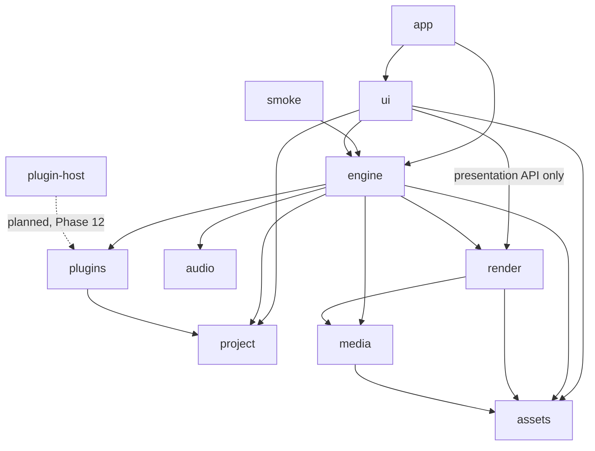
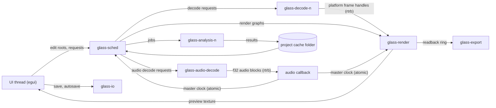
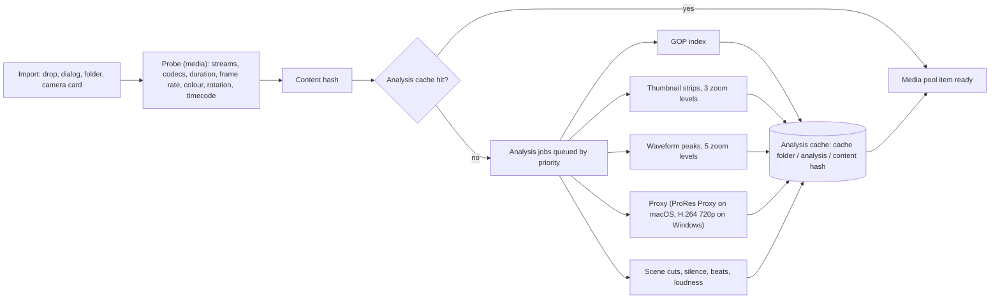
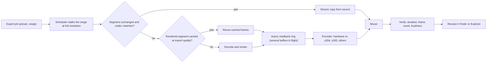
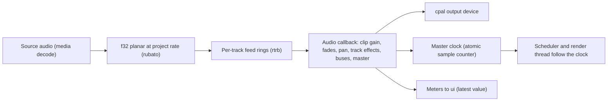

# Glass architecture

This document describes how Glass is built: the crates, the threads, how data moves between them, the caches, the GPU pipeline, and the stack chosen in Phase 0. `PLAN.md` is the source of truth for what gets built and in which order; this file is the source of truth for how the pieces fit. When a task changes data flow, this file changes in the same commit.

Status words used below:

- **Proven**: measured by a Phase 0 prototype in `experiments/proto-ui/`, `experiments/proto-gpu/` or `experiments/proto-decode/` (see [`experiments/README.md`](../experiments/README.md)).
- **Planned**: decided here, built in the phase named next to it.
- **Pending hardware**: decided, but the prototype could not run locally (no Windows PC, no NVIDIA GPU).

All local measurements come from an Apple M2 (8 logical cores, 10-core GPU), which stands in for the Apple M1 reference machine. The M1 is somewhat slower, so the numbers here are a lower bound for it.

---

## 1. Goals and budgets

Priority when goals conflict: **speed, then features, then size.**

| Budget | Limit | Enforced from | Current evidence |
| --- | --- | --- | --- |
| UI frame | under 8 ms at 120 Hz (8.33 ms per refresh) | Phase 1 frame-time monitor, every task | proto-ui: 200 clips on 10 tracks, UI-thread CPU (UI build + tessellation + paint + `Queue::submit`) median 0.37 ms, p99 0.74 ms offscreen; eframe `cpu_usage` in a window (excludes submit) median 1.37 ms, p99 3.00 ms |
| Scrub latency | under 50 ms | Phase 3 scrub benchmark | not measured yet |
| Project open | under 1 s | Phase 16 open benchmark | not measured yet |
| Cold start | under 1.5 s | Phase 16 benchmarks | not measured yet |
| Installer size | about 30 MB, excluding asset packs and models | Phase 1 size check (`scripts/size-check.sh` against `size-budget.toml`, 30 MiB per DMG, MSI, MSIX and AppImage) after each installer build in `package.yml` | arm64 DMG 11.99 MiB with the app icons (local, M2); this budget gives way to features and speed with a Decision Log entry |

Reference hardware: an Apple M1 Mac and a Windows PC with a GTX 1660 class GPU. Slower supported machines stay smooth by lowering preview resolution, never by dropping frames.

Consequences for every design choice below:

- The UI thread never blocks: no file I/O, no decode, no waiting on a GPU fence, no lock that another thread can hold for long.
- The audio callback never allocates, locks, or does I/O.
- Anything that can be computed ahead (thumbnails, waveforms, proxies, GOP indexes, rendered frames) is computed in the background and cached on disk or in memory.
- Everything cached is regenerable, except autosave data.

---

## 2. Crate layout

The Cargo workspace (Phase 1) has ten crates, each in `crates/<name>/` with a package of the same name. Two are binaries (`app` builds `glass`, `smoke` builds `smoke`); the rest are libraries. `experiments/` is excluded from the workspace. One more crate, `plugin-host`, is planned for Phase 12 and is not in the workspace yet; its row is marked *planned*.

| Crate | Responsibility | May depend on (workspace crates) | `unsafe` |
| --- | --- | --- | --- |
| `app` | The `glass` binary. Creates the eframe window (eframe creates the wgpu device and queue), passes that device and queue from `cc.wgpu_render_state` to `render`, starts the threads and the engine, then hands control to `ui`. Owns command-line flags, safe mode, portable mode, crash minidumps, and OS integration such as notifications. | `ui`, `engine` | only in `app::ffi` (attaching the crash handler, the deliberate test crash) |
| `ui` | egui panels and widgets: timeline, preview, media pool, inspector, browsers, colour, audio, export, settings, debug panel. Theme and i18n application. Turns input into edit commands and engine requests. The frame-time monitor (`ui::frame_time`) and the headless test harness (`ui::headless`). | `project`, `engine`, `render` (presentation API only), `assets` | only in `ui::ffi`, if window interop needs it (second display) |
| `engine` | Scheduler, playback state, master-clock consumer, timeline evaluation into render graphs, dirty-range invalidation, rendered-frame cache policy, look-ahead, background render, export pipeline, analysis job system. Logging setup and the in-memory log ring (`engine::logging`), used by every binary and read by the debug panel. | `project`, `media`, `render`, `audio`, `plugins`, `assets` | no |
| `media` | Safe wrapper over `ffmpeg-next`: demux, decode, encode, probe, hardware decode sessions, VFR maps, GOP index, still images, audio decode and resampling (`rubato`), analysis algorithms (thumbnails, waveforms, scene cuts, silence, beats, loudness), proxy generation. Produces platform frame handles, never wgpu objects. | `assets` (codec presets only) | only in `media::ffi` |
| `render` | Holds the shared wgpu device and queue it receives at startup (it never creates them), render graph compiler, compositor nodes, WGSL shaders, text via `cosmic-text`, vector shapes, masks, LUTs, scopes, VRAM frame cache storage, async readback ring, import of platform frame handles as textures, and the presentation API `ui` uses to show the preview. | `media` (frame handle and colour metadata types), `assets` | only in the platform interop module (`render::interop`) |
| `project` | The document: immutable edit tree (`im`), sequences, tracks, clips, transitions, keyframes, effect parameter schemas, project settings, undo history, save and load (`serde_json`), schema versions and migrations, autosave diffs. Pure data, no I/O threads, no GPU. | none | no |
| `audio` | `cpal` device I/O, the real-time callback, mixer graph, audio effects, meters, master clock, voice-over recording. | none (receives f32 blocks through ring buffers) | no |
| `plugins` | `wasmtime` host for Component Model effect, transition and title plugins, plugin manager, resource limits. Defines the host traits (edit operations, texture access, time and project info) that `engine` implements, so plugins and scripts reach the engine without a dependency cycle. Later: Lua scripting, optional Python bridge, VST3/AU helper-process protocol. | `project` (parameter schema types) | no |
| `assets` | Paths and loaders for bundled data: `assets/theme/`, `assets/i18n/`, fonts, `assets/transitions/`, `assets/titles/`, LUTs; the `t!()` macro; asset pack install locations. | none | no |
| `smoke` | Headless check binary: opens `tests/fixtures/reference.proj`, plays 2 s, exports 1 s, exits 0. | `engine` | no |
| `plugin-host` (*planned*, Phase 12, not in the workspace yet) | Separate sandboxed helper binary that loads VST3 and AU plugins and talks to the app over the `plugins` helper-process protocol and shared-memory audio rings. A crashing plugin takes down only this process. | `plugins` (protocol types) | only in `plugin-host::ffi` (VST3 and AU APIs) |

Dependency direction (an arrow means "depends on"; the dashed edge is planned). The graph has no cycles, and it matches the "May depend on" column. The test `crates/app/tests/dependency_direction.rs` holds the same edges in its `ALLOWED` list and fails when a crate's manifest adds a workspace dependency outside that list, or when the crate folders on disk differ from it. Changing an edge means changing the table, this diagram and that list in the same commit. Planned crates join the list when they are created.

Rules:

- `ui` never touches FFmpeg or wgpu internals. It shows the preview and GPU scopes through `render`'s presentation API (a texture id registered with the egui wgpu renderer plus its size and colour info) and asks `engine` for everything else. `ui` does not depend on `media`; probe results, thumbnails and waveforms reach it through `engine`.
- `media` does not depend on wgpu. Hardware decoders hand out platform handles (an `IOSurface`/`CVPixelBuffer` on macOS, a shared D3D11 texture handle on Windows, a DMA-BUF on Linux) or CPU planes; `render::interop` turns them into textures. The prototype kept both halves in one `ffi.rs`; the real crates split them along this line, so the Phase 2 zero-copy work spans both crates (see section 7).
- `project` has no dependencies inside the workspace, so the document model can be tested and fuzzed alone.
- `audio` has no dependencies inside the workspace, so the real-time code stays small and auditable.
- `unsafe_code = "deny"` is set for the whole workspace. A crate that must call platform APIs puts that code in one module named `ffi` (or `sys` or `interop`) with a local `#[allow(unsafe_code)]`, and keeps the rest of the crate safe. Current and expected modules: `media::ffi` (FFmpeg, VideoToolbox, D3D11VA, NVDEC, VAAPI), `render::interop` (Metal, DX12 and Vulkan texture import through wgpu-hal), `app::ffi` (the crash handler; later notifications), `ui::ffi` if second-display interop needs it, and `plugin-host::ffi` for VST3 and AU. Everything else is safe Rust; clippy runs with `-D warnings`.

Feature flags (Phase 1): `codec-av1`, `codec-prores-sw`, `ai-whisper`, `ai-segmentation`. Off by default for fast local builds, all on in release builds. The codec flags live in `media` and the AI flags in `engine` (until an AI module exists); `engine` forwards the codec flags and `app` forwards all four. Cargo features cannot depend on the build profile, so release builds pass `--features release-full`, an `app` feature that turns on all four. `crates/app/tests/features.rs` checks that each flag reaches its owner (`cargo test -p app --features release-full`).

---

## 3. Threading model

Every long-lived thread is named, so it shows up in profilers, crash reports and the debug panel (Phase 6).

| Thread | Name | Count | Owns | Must not |
| --- | --- | --- | --- | --- |
| UI | `main` (the process main thread, required by winit on macOS) | 1 | egui context, input, the current project root and undo history, the egui wgpu renderer, the frame-time monitor | block, do file I/O, decode, wait on a GPU fence, or hold a lock across a frame |
| Scheduler | `glass-sched` | 1 | playback state (play, pause, shuttle, loop), the latest project snapshot, timeline evaluation, look-ahead windows, the rendered-frame cache index, dirty-range invalidation | decode or render itself |
| Decode pool | `glass-decode-<n>` | one per active stream up to a cap sized from core count | demuxers and decoder sessions (hardware or software), GOP indexes in memory | touch the GPU (it hands out platform handles or CPU planes) |
| Audio decode | `glass-audio-decode` | 1 | audio decode and resampling into the per-track feed rings, at higher priority than video decode | wait behind video decode; a busy 4K decode pool must never starve the audio feeds |
| Render | `glass-render` | 1 | render graph compilation and execution, compositor resources, VRAM frame cache storage, texture import from decoded frames, the async readback ring | wait on the UI thread |
| Audio callback | owned by `cpal` (`glass-audio` where the backend allows naming) | 1 | the output stream, the mixer graph, meters, the master clock counter | allocate, lock, log, or do I/O |
| Analysis pool | `glass-analysis-<n>` | small, low priority | analysis jobs: thumbnails, waveforms, proxies, GOP index, scene cuts, silence, beats, loudness | block playback; jobs pause while the user scrubs or plays |
| Export | `glass-export` | 1 per running export | the encoder, the muxer, output verification | run faster than readback allows; it waits on its own readback ring, never on the UI |
| I/O | `glass-io` | 1 | project save, autosave diffs every 10 s, recovery files | run on the UI thread |

### Communication

- **Commands down, snapshots up.** The UI thread applies an edit to the immutable tree (cheap, structurally shared), pushes the new root onto its undo list, and sends an `Arc` of the root to the scheduler over a `crossbeam` channel. The scheduler diffs it against the previous root to find dirty ranges.
- **Frame queues** between decode, render and present are bounded lock-free queues (`rtrb` for single-producer single-consumer, `crossbeam` for multi-producer). A full queue means "look-ahead is deep enough"; producers skip work, they do not block the consumer.
- **Audio blocks** reach the callback through one `rtrb` ring per track feed. The callback only pops pre-decoded, pre-resampled f32 blocks. Parameter changes (gain, mute, effect settings) arrive through a separate `rtrb` command ring and are applied at block boundaries. Structural mixer changes (adding a track, bus or effect) build a new graph off the audio thread and send it through that ring; the callback swaps it in at a block boundary and sends the old graph back through a return ring, so it is dropped off the audio thread.
- **State for display** (playhead position, cache map, thread activity, meters) flows back to the UI as latest-value messages. The UI drains them with `try_recv` once per frame and repaints; it never waits for one.
- **Cancellation** uses a shared atomic generation counter per job family. Seeking or editing bumps the generation; workers drop stale requests without any lock.

### Logging

`engine::logging::init` (called first by `glass` and `smoke`) installs one global `tracing` subscriber: an `EnvFilter` read from `GLASS_LOG` (per-crate directives, for example `GLASS_LOG=engine=debug,info`; default `info` with `wgpu_core`, `wgpu_hal`, `naga` and `winit` at `warn`), a stderr writer, and a `RingLayer` that keeps the last 10,000 events in a `LogRing`. `log` crate records from dependencies go through the same filter. The ring is fixed-size and drops the oldest event when full; a writer reserves a sequence number with one atomic add and locks only the slot it writes, so writers on different threads do not wait on each other or on a reader. The debug panel (Phase 6) reads it through `engine::logging::ring()` with `snapshot` or, once per frame, `since(cursor, filter)`, which returns the new events and the next cursor (it stops before an event whose writer has reserved its number but not stored it yet, so a slow writer's event is read on the next poll instead of skipped), filtering by minimum level and target module; a full 10,000-event snapshot costs about 0.8 ms on the M2, so the UI polls incrementally. Recording one event costs about 0.14 µs (engine `log_ring` benchmark). The audio callback never logs: recording formats and allocates. It reports through its rings instead, and another thread logs on its behalf.

### Crash reports

Opt-in and local only; nothing is ever uploaded and the code has no network access. The setting defaults to off. Until the Settings dialog exists it is read at startup from `settings.json` in the user config folder (`{"crash_reports": true}`; `~/Library/Application Support/Glass` on macOS, `%APPDATA%\Glass` on Windows, `$XDG_CONFIG_HOME/Glass` on Linux), and `GLASS_CRASH_REPORTS=1` or `0` overrides it; `GLASS_CONFIG_DIR` and `GLASS_DATA_DIR` move the two folders (tests, later portable mode). The code is `app::settings` and `app::crash`.

When on, `glass` starts a second copy of itself as the crash monitor (`glass --crash-monitor <socket> <folder> <pid>`, a separate process, because a crashed process cannot be trusted to write its own dump) and connects to it twice over a local socket (EmbarkStudios `minidumper`; on macOS the dump request itself travels on a Mach port). The socket, `crash-<pid>.sock`, lives in a folder only the user can open, never in a shared `/tmp`: `$XDG_RUNTIME_DIR/glass` when that is set, else `run/` in the user data folder (both created `0700`), else on macOS the per-user `$TMPDIR/glass`; the first whose socket path fits the 103-byte Unix limit wins, and when none does minidumps are off for the session (panics are still reported). Windows uses the per-user `%TEMP%`. The first connection belongs to the native crash handler (`crash-handler`, attached in `app::ffi`, the crate's only unsafe code): on a fault or abort it sends one dump request and the monitor writes `crash-<UTC time>-<pid>.dmp` with `minidump-writer`. The second carries the report context: version and OS at startup, the GPU adapter once the renderer knows it (`crash::set_gpu_adapter`), and the last 200 log lines from the log ring, sent by the `glass-crash-log` thread once a second (a ping when nothing is new, so the monitor knows the app is alive). After the crashed app's connections close, so every message it sent has been read, the monitor writes `crash-<UTC time>-<pid>.txt` beside the dump and exits; it also exits when the app quits normally, when no app connects within 10 s, or when the app has been silent for 60 s. Log lines in a native crash report can therefore be up to a second old. A Rust panic is not a memory fault: the panic hook writes `panic-<UTC time>-<pid>-<n>.txt` (message, location, backtrace, the last 200 log lines) in process and no minidump. Everything goes to the user data folder's `crashes/`. `GLASS_DEBUG_CRASH=segfault|abort|panic` makes a debug build of `glass` crash on purpose (release builds compile the trigger out); `crates/app/tests/crash_reports.rs` uses it to check that a dump and a report appear with the setting on, and that nothing is written with it off or unset.

### Clock and sync

The master clock comes from the audio device callback: a monotonically increasing sample counter plus the device's reported output latency, published through an atomic. Video is slaved to it. The render thread picks the frame whose presentation time matches the clock at the next display refresh, and drift correction adjusts which frame is chosen, never the audio. Muting does not change the clock: while a device is open the callback keeps running (writing silence when muted) and keeps counting samples, so the playhead never jumps. Only when no audio device is open does a monotonic system clock stand in with the same interface; switching between the two re-bases the new clock on the current position. Frame pacing under load follows the adaptive-quality rule: preview resolution drops before any frame is dropped, and it restores when the machine is idle.

### Thread and data flow overview

---

## 4. Data flow

### Import and analysis

Probe runs on the decode pool and returns in milliseconds, so a clip appears in the media pool at once. Analysis jobs are cancellable, report progress, and resume from what is already cached. Visible clips get priority; everything pauses during playback and scrubbing.

### Edit to preview

```mermaid
flowchart LR
    A["User gesture in ui"] --> B["Edit command"]
    B --> C["New immutable root (im), pushed to undo list"]
    C --> D["Scheduler diffs old and new roots"]
    D --> E["Dirty ranges: affected segments only"]
    E --> F["Invalidate those frame cache entries"]
    F --> G["Scheduler plans frames around the playhead"]
    G --> H{"Frame cache hit?"}
    H -->|yes| M["Present"]
    H -->|no| I["Decode requests (look-ahead across cuts)"]
    I --> J["Decode pool: hardware or software"]
    J --> K["Render graph: import textures, composite, text, effects"]
    K --> L[("Frame cache: VRAM LRU, RAM spill")]
    L --> M
    M --> N["ui draws the preview texture"]
```

Scrub mode shows the nearest cached frame immediately, then the exact frame once the pointer has paused for 40 ms. Diffing two roots is cheap because unchanged subtrees are shared: pointer-equal nodes are skipped, so an edit costs work proportional to what changed.

### Export

Readback never stalls the UI: the render thread maps buffers asynchronously and the export thread consumes them as they complete. The proto-decode pattern (keep several submissions in flight, recycle a slot only after `on_submitted_work_done`) is the model for the readback ring.

### Audio

Effects that run inside the callback are preallocated and lock-free. Graph changes are built off the audio thread and swapped in through the command ring; the replaced graph goes back through a return ring and is dropped off the audio thread. Audio decode runs on its own `glass-audio-decode` thread ahead of video decode, so 4K video load cannot starve the feed rings. Heavy processing (spectral noise removal, loudness normalisation analysis) runs offline on the analysis pool and is cached. VST3 and AU plugins run in a sandboxed helper process (Phase 12) and exchange audio through shared memory rings, so a crashing plugin cannot take the app down.

---

## 5. Project model

- **Immutable edit tree.** The project is a tree of `im` persistent collections: project settings, sequences, tracks (video, audio, subtitle, adjustment), clips, gaps, transitions, markers, keyframe curves, effect stacks. Every edit produces a new root that shares all unchanged nodes with the old one.
- **Undo** is a list of roots, grouped per gesture, unlimited in depth. Undo and redo move an index; nothing is recomputed.
- **Autosave** writes diffs every 10 s to the cache folder on `glass-io`. On the next launch after a crash, the recovery prompt offers to restore them.
- **Files** are pretty-printed JSON (`serde_json`) with a stable key order, so projects diff cleanly in git. A 1000-clip project must round-trip byte-identically (Phase 5 Done when).
- **Versioned schema.** Every file carries a schema version. Loading runs one migration function per version step, each tested against fixtures from every prior version.
- **Segments.** For caching, a sequence is split into segments at every point where the set of contributing items changes. A segment hash covers everything that affects its pixels: source content hashes and ranges, effect parameters and keyframes, transitions, project render settings, and the renderer version.

---

## 6. Cache design

All caches live under the project cache folder, which defaults to `.glass-cache/` beside the project file and can be changed in project settings. User data (models, asset packs, settings) lives in the per-user data folder instead.

| Cache | Key | Where | Contents | Regenerable |
| --- | --- | --- | --- | --- |
| Analysis | content hash of the source file | `<cache>/analysis/<hash>/` | thumbnail strips (3 zoom levels), waveform peaks (5 zoom levels), GOP index, scene cuts, silence, beats, loudness | yes |
| Proxies | content hash plus proxy settings | `<cache>/proxies/` | ProRes Proxy (macOS) or H.264 720p (Windows) files, resumable | yes |
| Rendered frames, memory | (segment hash, frame index) | VRAM, spilling to RAM | composited preview frames | yes |
| Rendered frames, disk | (segment hash, frame index) | `<cache>/render/` | background-rendered idle regions, reused by smart export | yes |
| Autosave | project id and time | `<cache>/autosave/` | edit tree diffs for crash recovery | **no, never evicted by cache cleanup** |

Rules:

- **Content hash** identifies a source file by its bytes, not its path, so relinking, renaming and moving media keep the cache valid. The hash samples the file (size plus fixed blocks) so hashing a large file stays fast; the exact scheme is fixed in the Phase 2 analysis job system task.
- **Rendered-frame cache** is an LRU in VRAM with RAM spill and a configurable ceiling. Evicting from VRAM spills to RAM; evicting from RAM drops the frame. Dirty-range invalidation removes only entries whose segment hash changed, which a test verifies by counting re-renders (Phase 3).
- **Memory ceiling** (Phase 16): total cache memory is capped so the machine never swaps. Battery mode lowers preview resolution and pauses background analysis.
- **Disk rules.** Caches are the first thing reclaimed when disk space runs low, in this order: rendered frames on disk, proxies, thumbnails and waveforms, then everything else regenerable. Autosave data and source media are never deleted by cleanup. On the development machine, PLAN.md sets the thresholds: below 15 GB free, run `cargo sweep --time 7`, then delete regenerable caches under the project cache folder, then `cargo clean`; below 10 GB after cleanup, stop and flag the task for a person. The app's own user-facing thresholds and settings UI are set in Phase 16 (memory ceiling) and the Settings dialog.
- **Deterministic hashing** is the mitigation for stale frames (Risk register): same inputs, same hash, same pixels, backed by the visual regression suite.

---

## 7. GPU pipeline

- **API.** `wgpu` with WGSL shaders: Metal on macOS, DX12 on Windows, Vulkan on Linux. One device and queue, created by eframe and shared by the render thread and the egui renderer on the UI thread (wgpu devices and queues are `Send + Sync`). `render` takes them from `cc.wgpu_render_state` at startup; if `render` ever needs adapter or device options eframe cannot request through its wgpu configuration, `app` creates the device itself and gives it to eframe with `WgpuSetup::Existing`. Either way there is exactly one device and `render` never creates its own.
- **Render graph** (Phase 4). Per frame, the engine builds a DAG of nodes (source, transform, blend, text, shape, mask, effect, transition, LUT) that `render` compiles into wgpu passes, aliasing intermediate textures whose lifetimes do not overlap.
- **Colour.** Sources are converted into a linear-light working space on import to the graph. Intermediates are `Rgba16Float`. Output to the preview or an 8-bit encoder is dithered. Colour metadata (BT.709, BT.2020, sRGB, limited or full range, 8/10/12-bit, PQ and HLG) travels on every frame from `media`.
- **Text** uses `cosmic-text` for shaping and layout with a glyph atlas (proto-gpu used `glyphon`, which is built on it).
- **Proven cost.** proto-gpu, 4K dissolve plus a two-line title and a timecode re-shaped every frame, Metal on M2: total GPU time median 0.72 ms, p99 0.77 ms with `Rgba8UnormSrgb` output; 0.92 ms p99 with `Rgba16Float` output; wall time (encode, submit and wait) p99 1.12 ms. The budget was 2 ms. Apple GPUs overlap consecutive passes, so per-pass timestamps overlap and are not quoted; total GPU time is the judged number. The text pass loads and stores the whole 4K target, so folding overlays into the previous pass is the first optimisation if the budget tightens.

### Zero-copy hardware decode

PLAN's Phase 2 zero-copy "Done when" spans two crates. `media` produces the platform handles (`IOSurface`/`CVPixelBuffer` on macOS, D3D11 shared texture handles on Windows) with their colour metadata, and its tests check handle production. `render::interop` imports those handles as wgpu textures without a CPU copy, and its tests check import and NV12 conversion against reference frames. The end-to-end check (no CPU copy, CPU budget) lives in `engine`'s integration tests, the first crate that sees both halves.

| Platform | Path | Status |
| --- | --- | --- |
| macOS | FFmpeg VideoToolbox hwaccel → `CVPixelBuffer` → `IOSurface` → Metal texture per NV12 plane → wgpu texture via wgpu-hal → WGSL BT.709 conversion | **Proven** (proto-decode): 4K60 H.264 paced at 60 fps with a 3-frame look-ahead, 0 late frames, 2.06% of the machine (8.58% process plus 7.88% VTDecoderXPCService, each as % of one core; first run with a looser 6-slot pacing window: 2.18%). Two wrapping paths both passed: a `CVMetalTextureCache` per frame (judged run) and IOSurface textures cached by surface id (2.21%); two paced streams cost 1.81% of the machine each. GPU conversion matches the FFmpeg CLI within 1 level (mean absolute difference 0.001). |
| Windows | D3D11VA → shared texture handle → DX12 texture, no CPU copy; NVDEC as the second choice | **Pending hardware**: needs a Windows PC to prototype |
| Linux | VAAPI → DMA-BUF → Vulkan image import | Planned (Phase 2, parallel) |
| Any | Software decode, planes uploaded with `queue.write_texture` | Planned (Phase 2). Automatic per-file fallback, with a reason string shown in the UI |

Next steps recorded by proto-decode for the engine: drive a `VTDecompressionSession` directly with asynchronous output instead of FFmpeg's synchronous hwaccel (keeping FFmpeg for demuxing and software fallback); keep several decoded frames in flight end to end, sized by the look-ahead queue; fold the NV12 conversion into the compositor's frame and keep the IOSurface texture cache. The engine's cache keys on (surface id, width, height, pixel format), not the surface id alone, because a freed surface's id can be reused for a surface of a different size or format.

---

## 8. UI

- **Toolkit.** `egui` with `eframe` on `winit`, rendering through wgpu. proto-ui (egui 0.36, wgpu Metal, 200 clips on 10 tracks, 1440 x 748 points at 2x): UI-thread CPU per frame (UI build, tessellation, paint encoding and `Queue::submit`, which eframe's `cpu_usage` leaves out) median 0.37 ms, p99 0.74 ms with off-screen culling and 0.60 / 0.79 ms without, measured offscreen; `Queue::submit` itself is about 6 µs on Metal. The original windowed run measured eframe's `cpu_usage` at median 1.37 ms, p99 3.00 ms (1.09 / 3.13 ms without culling); the windowed rerun with submit included is still to do on an unlocked screen. The frame interval p99 (about 13 ms) was surface acquire and present wait, not CPU work; the frame-time monitor tracks it once real frames are drawn. The timeline widget stays self-contained so the toolkit could be swapped (fallback: `iced`).
- **Theme.** Tokens live in `assets/theme/`, one file per theme (default dark, light, high contrast), loaded into the egui style. Values come from the Paper file "Inspiration 2" (`00 Foundations` page), which is authoritative where it differs from the defaults in `DESIGN_HANDOFF.md`: Geist and Geist Mono instead of Inter and JetBrains Mono, floating radius 8 instead of 6, added `glass/*` tokens, extra spacing steps 48 and 64 for board margins only, and no separate high-contrast tokens. Token roles: `bg/0` to `bg/3`, `border/subtle`, `border/strong`, `text/primary`, `text/secondary`, `text/muted`, `text/inverse`, `accent`, `accent/soft`, `state/*`, `clip/*`, `scope/*`, plus `glass/*` (top, bottom, edge, highlight, shadow) for the glass sheen on controls and floating surfaces. Dark is the default. The high-contrast theme reuses the dark tokens: all text in `text/primary`, dividers in `border/strong`, surfaces in `bg/0`. Type: Geist (400, 500) for UI and Geist Mono for timecode and numbers, both OFL and bundled; scale display 24/32, title 18/24, body 14/20, label 12/16, caption 11/14, mono 12/16. Spacing 2, 4, 8, 12, 16, 24, 32. Radius 0 panels, 4 controls, 8 floating, 999 pills. In code, `assets::theme` parses the embedded token files (`ThemeColors` per theme, `Tokens` for the shared scale, the `Role` enum with all 31 roles) and `ui::theme` turns them into egui: `Theme::style` maps roles onto `Visuals` (panel and window fills `bg/1`, text-edit background `bg/0`, hairlines `border/subtle`, hover `bg/3` with `border/strong`, selection `accent/soft` with an `accent` stroke, floating radius and the `0 16 48` shadow in `glass/shadow`, disabled opacity) and tokens onto `Spacing` (8 px gutters, 24 px Pro controls) and text styles (caption, body, label, title in the medium family, mono, plus named `display`, `title`, `label`, `caption`). `Theme::apply(ctx)` installs the fonts once and the style for the theme's egui mode; `ui::theme::set(ctx, kind)` switches at run time, and custom painting asks `ui::theme::current(ctx).color(Role::ClipVideo)`. `crates/ui/src/theme.rs` is the only UI module allowed to build a colour from numbers: `crates/app/tests/ui_source.rs` (CI check job) fails on `Color32::from_*`, `Color32::RED`-style constants (`TRANSPARENT` and `PLACEHOLDER` excepted), `hex_color!` and hex colour strings anywhere else in `crates/ui/src` or `crates/app/src`, with `// allow-literal-colour: <reason>` for debug-only colours; `assets/theme/check.py` validates the token files and contrast in the same job.
- **i18n.** Every user-facing string is a key in `assets/i18n/en.json` (flat dotted keys such as `settings.crash_reports.title`, named `{placeholders}`; format in [`assets/i18n/README.md`](../assets/i18n/README.md)), looked up with `t!("key")` or `t!("key", name = value)`. The macro and the loader live in `assets::i18n` (`ui` re-exports `t!`): English is embedded with `include_str!`, other locales load with `Locale::from_json` and switch with `set_locale`, and each locale carries a `direction` flag for right-to-left layout. A key missing from the current locale falls back to English; one missing from English shows as `⟦key⟧` and logs one warning, never a panic. The source check `crates/app/tests/ui_source.rs` (CI check job) fails when a used key is missing or passes the wrong placeholders, or when a literal string with words reaches an egui text API in `crates/ui/src` or `crates/app/src` outside `t!()` (escape: `// allow-literal-text: <reason>` for debug-only strings); unused keys are warnings. Right-to-left layout mirrors panels while the timeline stays left-to-right in time (Phase 6).
- **Frame-time monitor** (Phase 1, `ui::frame_time`). `FrameTimeMonitor` lives on the UI thread and records every frame's UI-thread duration into a fixed ring of the last 1,024 frames (no allocation per frame, about 4 ns per record on the M2). It exposes p50, p95, p99 and max over that window, a budget (8 ms by default, for 120 Hz) and a count of frames over it; a stats call sorts a preallocated copy (about 5 µs). The debug panel shows them. It is the gate for "no UI-thread stall over 8 ms" on every task: UI tests run their screens through `ui::headless::HeadlessUi`, which drives the same `egui::Context` and `egui_wgpu::Renderer` path eframe uses into an offscreen texture (so it works on a locked screen and in CI), time UI build, tessellation, upload, encoding and `Queue::submit` per frame, and call `HeadlessUi::assert_p99_within_budget`, which holds the p99 to the budget on a hardware adapter and only reports it on a software rasteriser (`DeviceType::Cpu`: lavapipe, WARP). The harness creates its own wgpu device and is for tests and benchmarks only. Without a GPU it prints a SKIPPED line instead of passing silently, and `GLASS_REQUIRE_GPU=1` turns that, or a software adapter, into a failure (set on CI's macOS arm64 job; the Linux job installs lavapipe so its frames render). `crates/ui/tests/frame_budget.rs` is the first gate: a top bar, a side panel and a 200-clip timeline, 240 frames at 2880 x 1496, p50 2.31 ms, p99 2.63 ms on the M2 in a debug build.
- **Fonts.** egui's `default_fonts` feature is off (it bundles the Ubuntu font, which `deny.toml` rejects); Geist and Geist Mono ship in `assets/fonts/`. Without any font egui draws no text at all. `crates/assets/build.rs` embeds each of `Geist-Regular`, `Geist-Medium`, `GeistMono-Regular` and `GeistMono-Medium` (`.ttf`) found in `assets/fonts/` at build time; `assets::fonts::load` falls back per face (Medium to Regular, then a system UI font from the standard OS locations, mono to proportional) and logs which source it used. The design files are not in the repo yet ([`assets/fonts/README.md`](../assets/fonts/README.md) lists the official files to add), so builds currently use the system font. `ui::fonts::install` registers the egui families `Proportional`, `Monospace`, `medium` and `mono-medium`, loading the files once per process at startup.
- **Density.** Pro panels: 28 px rows, 8 px gutters, 12 px labels. Beginner surfaces: 40 px rows, 16 px gutters, 14 px labels.

---

## 9. Plugins, scripting and AI

- **Plugins** (Phase 15): `wasmtime` with the Component Model ABI. An effect, transition or title plugin receives typed parameters, input textures, time and project info through the ABI, and runs sandboxed: no file system or network access unless granted, with memory and execution limits enforced by the plugin manager. Effect parameters use the same schema as built-in effects, so the inspector UI is generated the same way. Plugins and scripts reach engine operations and textures only through host traits defined in `plugins` and implemented by `engine`, which keeps the dependency one way (`engine` depends on `plugins`, never the reverse).
- **Audio plugins** (Phase 12): VST3 and AU run in the separate sandboxed `plugin-host` helper binary (planned crate, section 2), never in the app process.
- **Scripting** (Phase 15): Lua for batch operations and automation; an optional Python bridge behind a feature flag.
- **AI features** (Phase 10) run on-device. Models (for example `whisper-rs` speech-to-text, segmentation) download on demand into the user data folder through the model manager, which verifies, caches and deletes them. Nothing is downloaded into the repo or bundled in the installer. Each feature sits behind a Cargo feature flag (`ai-whisper`, `ai-segmentation`), all on in release builds.
- **No telemetry.** Crash minidumps are opt-in, written locally, and never uploaded automatically (section 3, Crash reports).

---

## 10. Packaging and licensing

- **Source** is MIT.
- **Release builds** are distributed under GPLv3 because they bundle a GPL shared build of FFmpeg 9.0.x with x264 and x265, used through `ffmpeg-next` 9. Every release bundles the licence texts and attaches the exact FFmpeg, x264 and x265 source archives it was built from. `cargo-deny` allows only GPLv3-compatible licences.
- **FFmpeg** is built by a pinned build script (`scripts/ffmpeg/build.sh`, FFmpeg 9.0.2) as shared libraries for every target and cached in CI (Phase 1). Locally, `scripts/dev-env.sh` points `FFMPEG_DIR` at that build, or at Homebrew's FFmpeg when it is missing; no machine-specific path is committed.
- **Installers.** A `v*` tag runs `release.yml`, generated by `cargo-dist` 0.32 from `dist-workspace.toml`, which builds the `glass` binary of the `app` package with `--features release-full` for aarch64 and x86_64 macOS, x86_64 Windows and x86_64 Linux. dist itself produces per-target archives and the Windows MSI (WiX, `crates/app/wix/main.wxs`, with the FFmpeg DLLs, licences and GPL notice added from a fragment written in CI). dist 0.32 has no DMG, MSIX or AppImage support, so `package.yml` (a dist local-artifacts job) builds those with `scripts/package/`: `make-dmg.sh` (`Glass.app` with the FFmpeg dylibs in `Contents/Frameworks` rewritten to `@rpath`, an rpath of `@executable_path/../Frameworks`, licences and notice in `Resources`, compressed DMG), `make-msix.sh` and `make-appimage.sh`, plus the GPL source bundle. Everything uploaded as `artifacts-*` lands in the GitHub Release. dist's plain archives carry the binary without the FFmpeg libraries; the installers are the supported downloads. After each DMG, MSIX and AppImage is built, `scripts/size-check.sh` compares it with its budget in `size-budget.toml` and fails the job when it is over; the MSI is built inside dist's own job, which has no step after the build, so its budget is not enforced there yet. Asset packs and models download on demand so the installers stay near 30 MB.
- **Targets**: macOS 12 arm64 and x86_64, Windows 10 x86_64, Linux best effort. Local builds are arm64 only; other targets build in CI.

---

## 11. Phase 0 defaults and their status

The table below is PLAN.md's defaults table, copied verbatim, with a Status column added.

| Concern | Default | Fallback | Status |
| --- | --- | --- | --- |
| UI toolkit | `egui` with `eframe` on `winit` | `iced` | Confirmed by proto-ui (M2, Metal): 200 clips, UI-thread CPU including `Queue::submit` median 0.37 ms, p99 0.74 ms offscreen (windowed eframe `cpu_usage` 1.37 / 3.00 ms) against a median under 4 ms and p99 under 8 ms budget |
| GPU | `wgpu`, WGSL shaders, Metal on macOS, DX12 on Windows, Vulkan on Linux | none | Metal confirmed by proto-gpu (M2): 4K dissolve plus text, total GPU median 0.72 ms, p99 0.77 ms against 2 ms. DX12 on a GTX 1660 class GPU pending hardware. Vulkan adopted without prototype |
| Decode/encode | `ffmpeg-next` against a GPL shared FFmpeg 9.0.x build with x264 and x265 | none | Decode confirmed by proto-decode on macOS (`ffmpeg-next` 9 against Homebrew FFmpeg 9.0.1, GPL shared, x264 and x265). Encode adopted without prototype (Phase 8) |
| HW decode | VideoToolbox (macOS), D3D11VA then NVDEC (Windows), VAAPI (Linux), software fallback | software | VideoToolbox confirmed by proto-decode: 4K60 H.264 at 60 fps with a 3-frame look-ahead, 0 late, 2.06% of the machine against under 5% per stream. D3D11VA pending hardware (Windows PC). NVDEC, VAAPI and the software fallback adopted without prototype |
| Audio I/O | `cpal` | none | Adopted without prototype |
| Text shaping | `cosmic-text` | `rustybuzz` + `swash` | Confirmed by proto-gpu through `glyphon` (built on `cosmic-text`): 4K dissolve plus text re-shaped every frame, total GPU p99 0.77 ms, wall p99 1.12 ms (per-pass timestamps overlap on Apple GPUs, so no separate text-pass figure) |
| Persistent data | `im` crate for the edit tree, `serde_json` for files | `rpds` | Adopted without prototype; Phase 5 round-trip and undo tests confirm it |
| Plugins | `wasmtime`, Component Model ABI | none | Adopted without prototype |
| Speech-to-text | `whisper-rs`, models downloaded on demand | none | Adopted without prototype |
| Packaging | `cargo-dist` | hand-written CI | Adopted without prototype |
| Min targets | macOS 12 arm64 + x86_64, Windows 10 x86_64 | Linux best effort | Adopted without prototype; only macOS arm64 is built locally |

Prototype sources and full result tables: [`experiments/proto-ui/RESULTS.md`](../experiments/proto-ui/RESULTS.md), [`experiments/proto-gpu/RESULTS.md`](../experiments/proto-gpu/RESULTS.md), [`experiments/proto-decode/RESULTS.md`](../experiments/proto-decode/RESULTS.md). Decisions and their reasons: [`DECISIONS.md`](DECISIONS.md).
